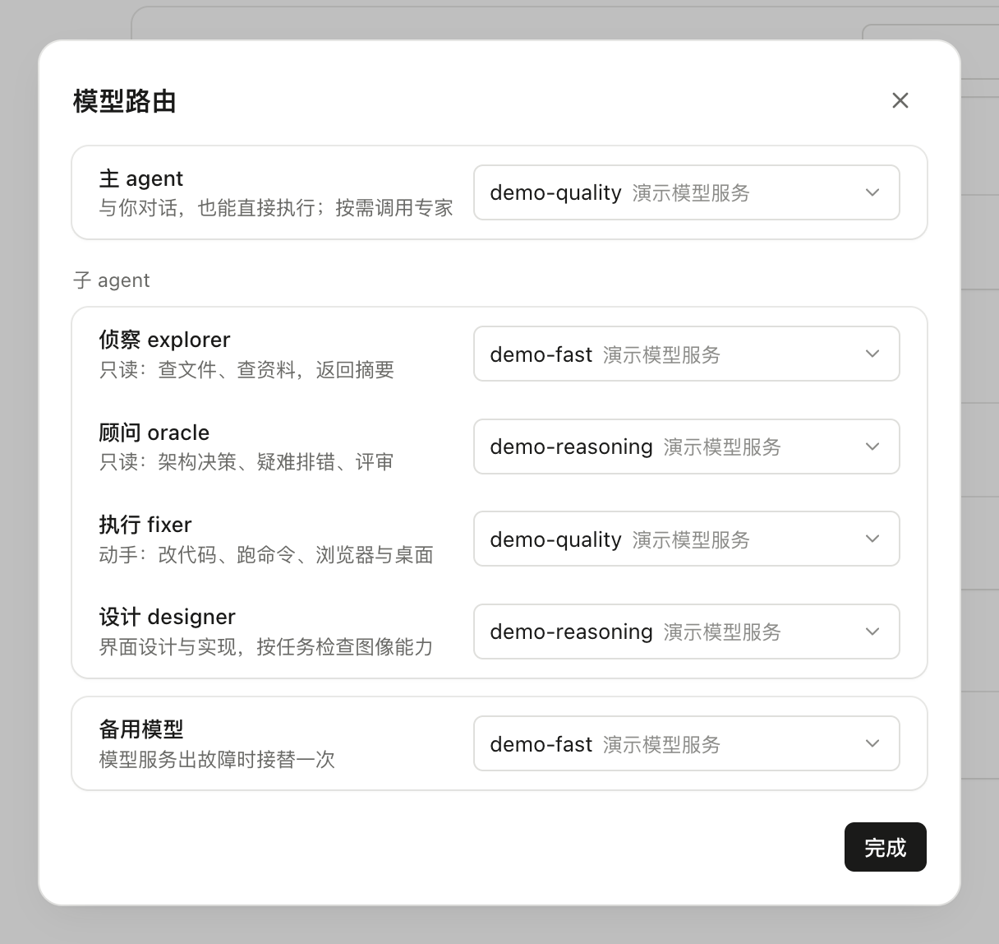
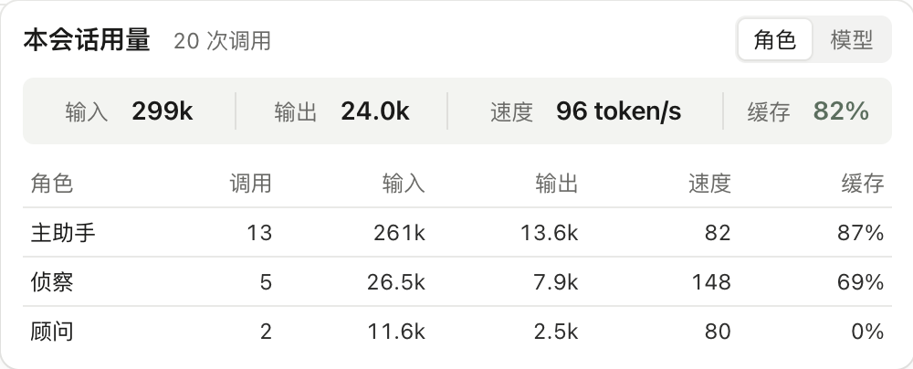
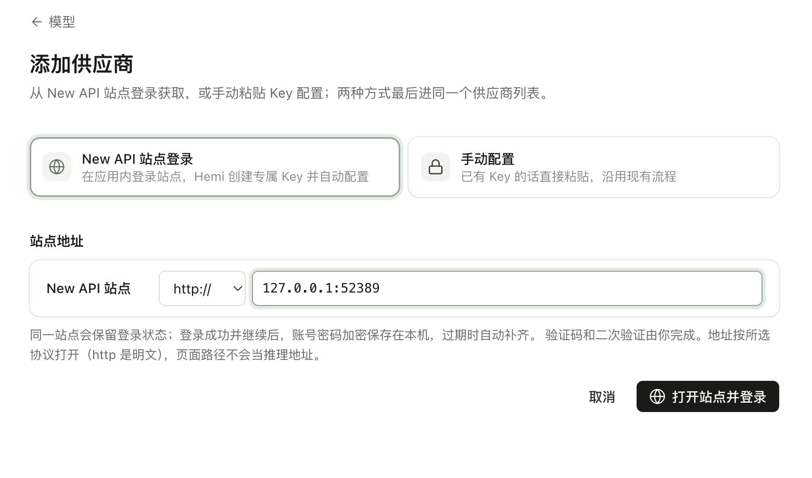
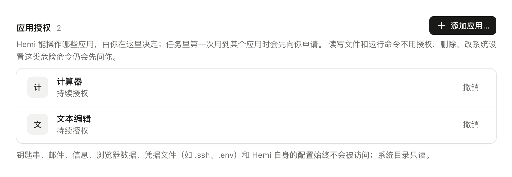
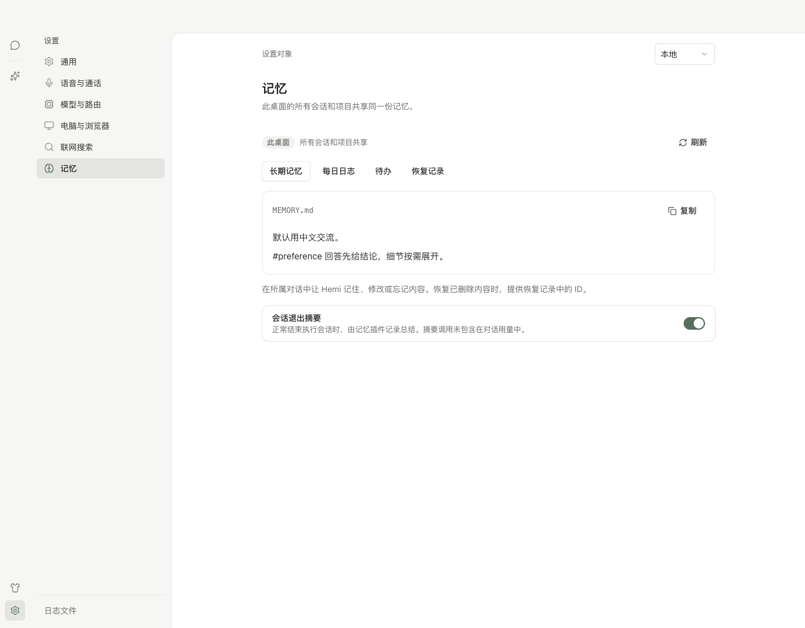

# Hemi

English · [简体中文](README.zh-CN.md)

Hemi is a macOS AI assistant. Give it a task by voice or text and let it act on your computer.

[Download for macOS (Apple Silicon) and Windows (x64)](https://github.com/PiuQiuPiaQia/Hemi/releases/latest)

## Model routing and cost control

Configure models for the main agent and individual roles. Delegate as needed to balance capability and API cost, with request usage recorded for review.

[](docs/media/screenshots/feature-routing.png)

[](docs/media/screenshots/feature-usage.png)

## Model account sign-in

Connect ChatGPT, Claude, or GitHub Copilot under Settings → Models and routing → Add provider → Account sign-in. After browser authorization, select the imported models for conversations and role routing. Credentials are encrypted locally and refreshed automatically. Reconnect or sign out at any time; one account is stored per provider. Model access and usage limits depend on the provider.

## New API sign-in

Sign in to a supported New API site inside Hemi. Create a dedicated key, verify the endpoints, and import model settings. Retain sessions and autofill saved credentials when signing in again.

[](docs/media/screenshots/feature-newapi.png)

## App-level permissions

Grant desktop access per app, for a task or on an ongoing basis, and revoke it at any time. Dangerous commands still require separate confirmation.

[](docs/media/screenshots/feature-app-permissions.png)

## Automatic memory

Each desktop and Bot has one shared memory library powered directly by pi-memory. All conversations and projects in that instance share long-term memory, daily logs, and a scratchpad. Manage memory through the original tools in conversation and browse its files in Settings.

[](docs/media/screenshots/feature-memory.png)

## Run from source

macOS (Apple Silicon), Node.js 22.19+.

```bash
npm ci
npm run dev
```

Set up a model in **设置 → 模型与路由** (Settings → Models and routing).

## License

[MIT](LICENSE) · [Third-party notices](THIRD-PARTY-NOTICES.md) · [Screenshot sources](docs/media/screenshots/SOURCES.md)

[Development](docs/development.md) · [Contributing](CONTRIBUTING.md) · [Security and privacy](SECURITY.md)
