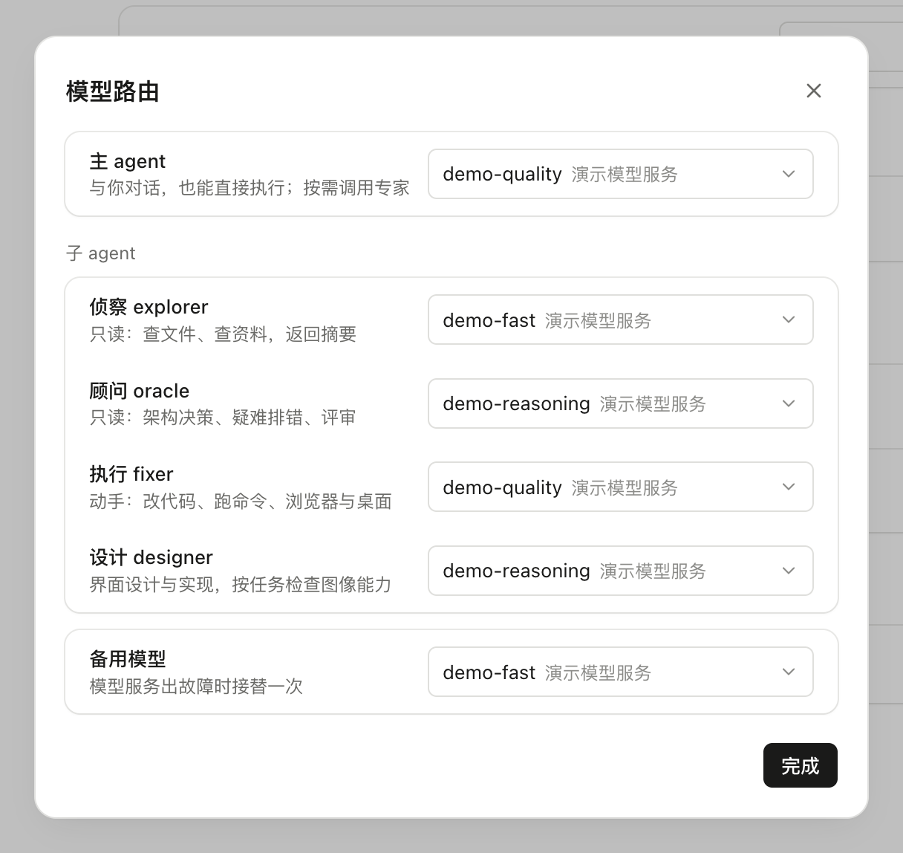
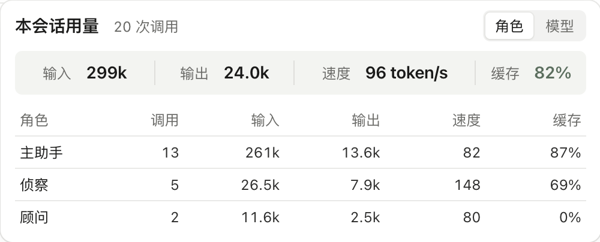
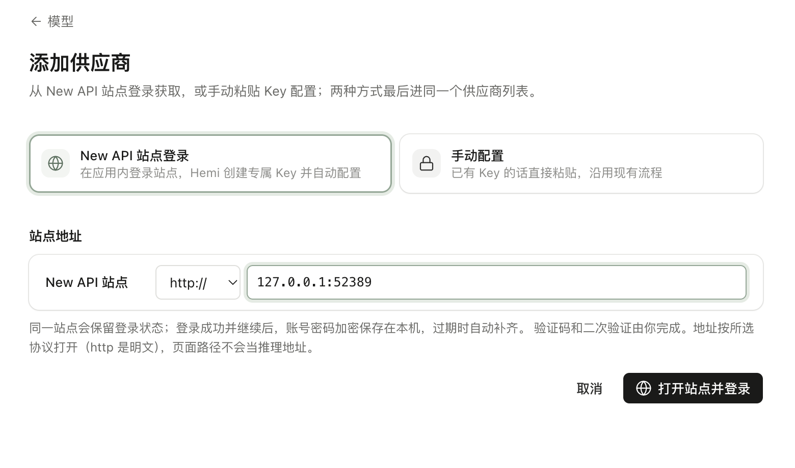
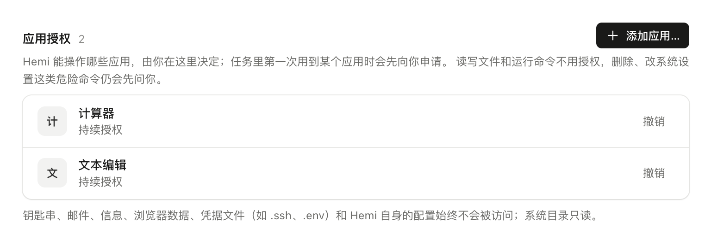
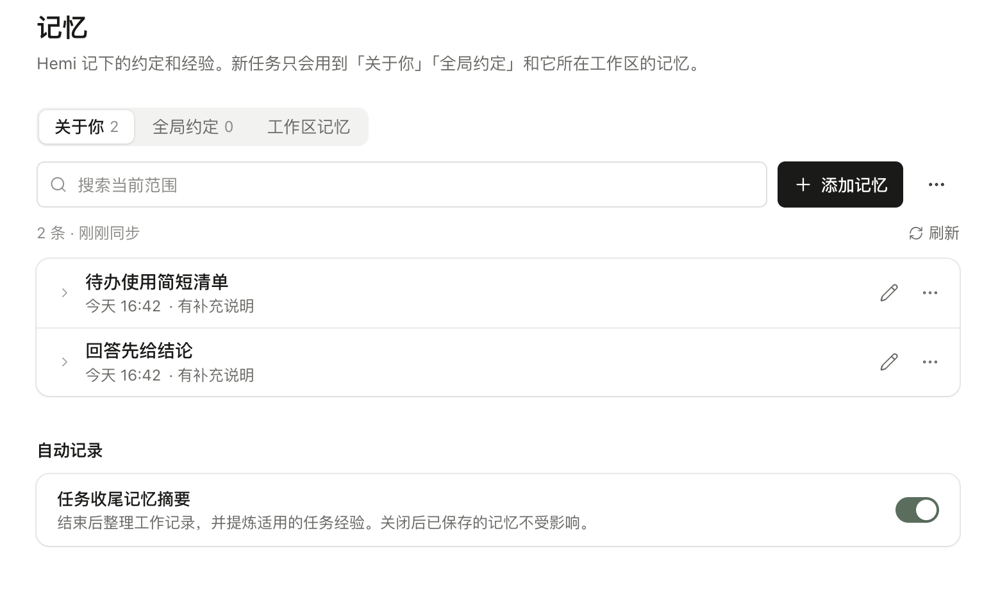

# Hemi

English · [简体中文](README.zh-CN.md)

**Hemi** is a desktop AI assistant for macOS (Apple Silicon) and Windows (x64). Give it a task by voice or text — it works on your computer and hands you the result. Not just ideas, but work you can use.

[Download for macOS (Apple Silicon) and Windows (x64)](https://github.com/PiuQiuPiaQia/Hemi/releases/latest)

## See it in action

https://github.com/user-attachments/assets/0bf5a0a1-dee3-4e93-b9f2-1bbdf6a5ac66

<sub>[Download the original video](https://hemi-agent.oss-cn-beijing.aliyuncs.com/hemi-features-final.mp4)</sub>

## What it can do

### Use the AI you already have

Connect a supported subscription account, a New API site, or a custom endpoint with your API key. Manage your models together under **Settings → Models and routing**, without replacing the AI services you already use. Account-based model access and usage limits depend on the provider.

### The right model for the right job

Choose models for the main agent and for research, review, execution, and design roles. Hemi delegates when it helps the task, balancing capability and API cost. Review per-role requests, input/output tokens, and cache usage in the conversation.

### Work beyond this machine

Work on remote hosts over SSH, or hand tasks to a Bot deployed on your own server. Regular SSH work requires your computer to stay connected. With its server online, a Bot can continue accepted tasks after you close Hemi or disconnect, pausing when it needs new approval or input.

### Remember what matters across conversations

Ask Hemi to remember your preferences and important decisions for future tasks. Conversations and projects in the same instance share long-term memory, daily logs, and a scratchpad. Each desktop and Bot keeps its own memory; it does not sync across hosts automatically.

### Save routine work as workflows (Beta)

Build reusable flows for tasks such as video editing, preparing posts, and organizing research. Create a flow in the editor, then review its inputs and start it whenever you need it. Scheduled triggers are not supported yet.

## App-level permissions

Desktop access is granted per app — for a single task or on an ongoing basis — and can be revoked at any time. Dangerous commands still require a separate confirmation.

## Quick start

1. [Download](https://github.com/PiuQiuPiaQia/Hemi/releases/latest) and install.
2. Configure a model under **Settings → Models and routing**: account sign-in, New API, or a custom API. Text tasks work as soon as a model is set up.
3. Voice input requires configuring a speech service in Settings first.

## Run from source

Source development is verified on macOS (Apple Silicon). Use Node.js 22.19 or later in the Node 22 line.

```bash
npm ci
npm run dev
```

Architecture, tests, and packaging: the [development guide](docs/development.md).

## Screenshots

<details>
<summary>Expand</summary>

[](docs/media/screenshots/feature-routing.png)

[](docs/media/screenshots/feature-usage.png)

[](docs/media/screenshots/feature-newapi.png)

[](docs/media/screenshots/feature-app-permissions.png)

[](docs/media/screenshots/feature-memory.png)

What each image shows and how it was captured: [Screenshot sources](docs/media/screenshots/SOURCES.md).

</details>

## License and links

[MIT](LICENSE) · [Third-party notices](THIRD-PARTY-NOTICES.md) · [Screenshot sources](docs/media/screenshots/SOURCES.md) · [Video and poster sources](docs/media/PROMO.md)

[Development](docs/development.md) · [Contributing](CONTRIBUTING.md) · [Security and privacy](SECURITY.md)
