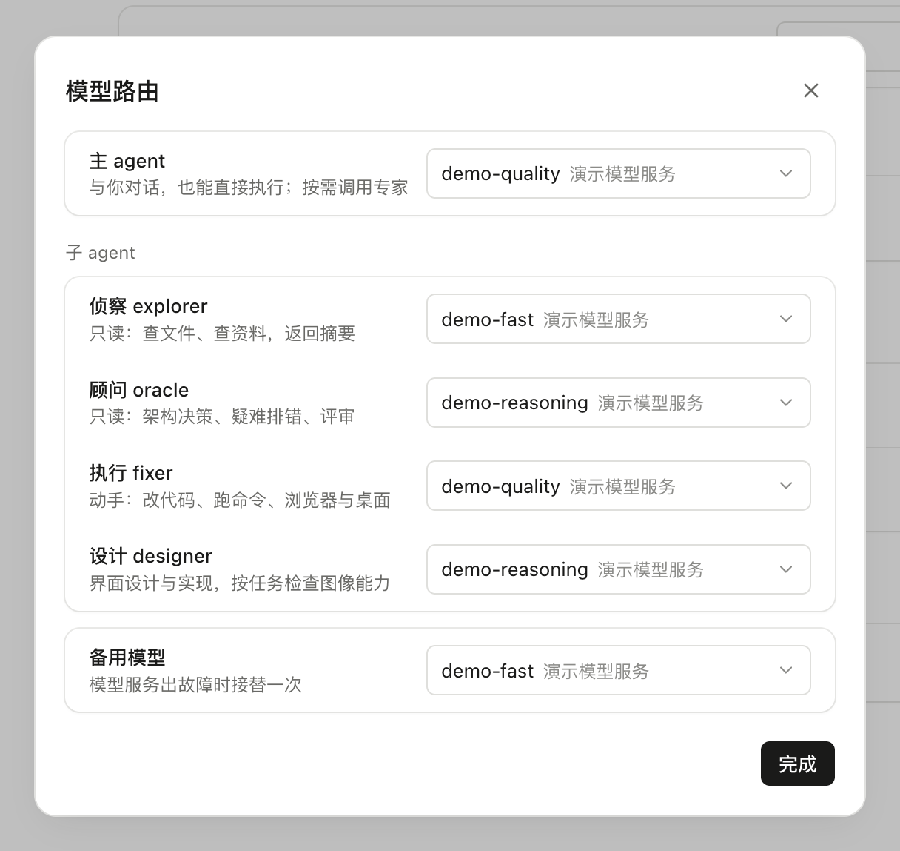
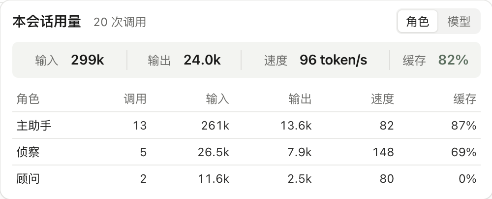
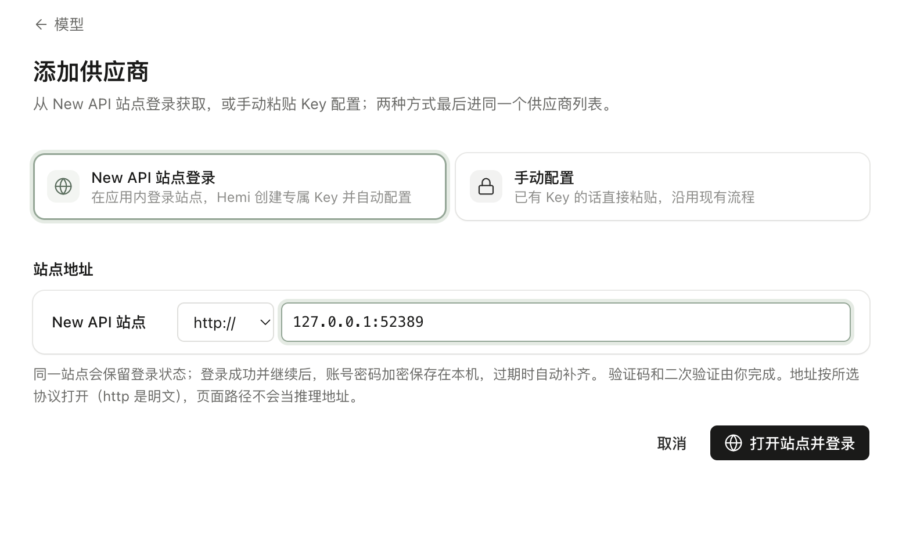
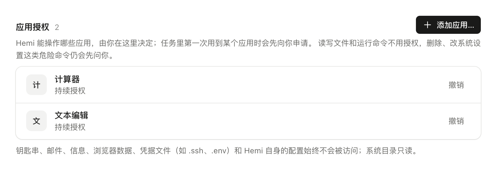
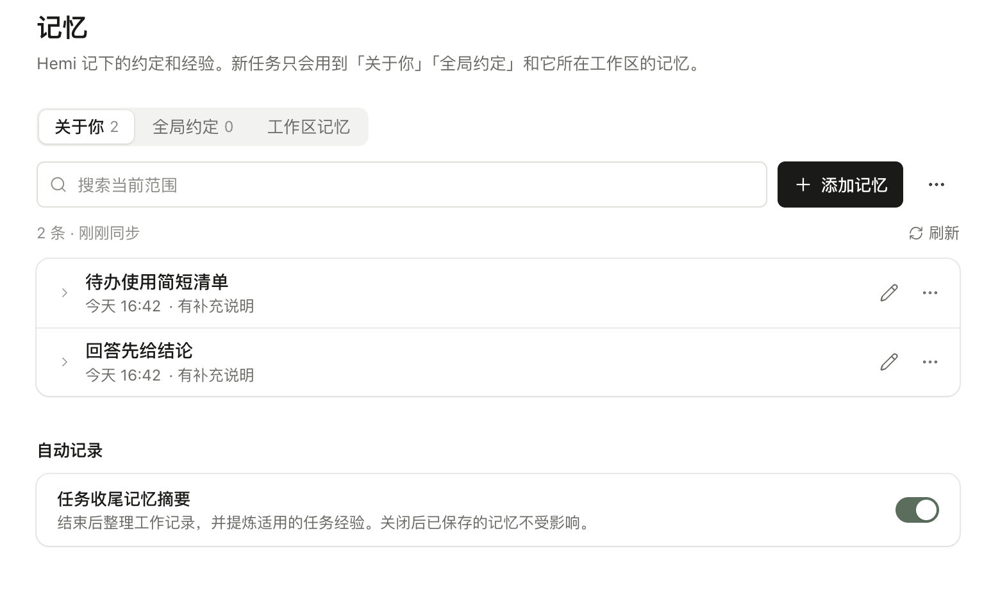

# Hemi

[English](README.md) · 简体中文

**Hemi** 是一款会动手的桌面 AI 助手，支持 macOS（Apple Silicon）与 Windows（x64）。用文字或语音交代一件事，它在你的电脑上把活干完，把结果交到你手里——不止帮你想，陪你做到交付。

[下载安装包：macOS（Apple Silicon）／Windows（x64）](https://github.com/PiuQiuPiaQia/Hemi/releases/latest)

## 看看它能做什么

https://github.com/user-attachments/assets/0bf5a0a1-dee3-4e93-b9f2-1bbdf6a5ac66

<sub>[下载原片](https://hemi-agent.oss-cn-beijing.aliyuncs.com/hemi-features-final.mp4)</sub>

## 它能帮你做的

### 用你已有的 AI

连接支持的订阅账号、New API 站点，或通过接口地址和 API Key 自定义接入。在「设置 → 模型与路由」集中管理常用模型，不必换掉已有的 AI 资源。账号可用模型与额度由对应服务商决定。

### 合适的模型做合适的事

主模型和侦察、顾问、执行、设计等角色可分别配置模型，按任务需要分工协作，兼顾能力与调用成本。每次请求的用量都有记录，可在会话中查看各角色调用与输入输出、缓存统计。

### 不止在这台电脑上工作

通过 SSH 在远程主机上干活，也可以把任务交给部署在你自己服务器上的 Bot。普通 SSH 工作需要本机保持连接；服务器在线时，Bot 已受理的任务可在你关闭本机或断开后继续推进，需要新授权或补充输入时会等待你确认。

### 说过一次，下次照做

让 Hemi 记住你的偏好和重要决定，在之后的任务中沿用。同一实例的会话与项目共享长期记忆、每日日志和待办；桌面与每个 Bot 各自保存，不会自动跨主机同步。

### 常做的事存成工作流（Beta）

把视频剪辑、文案发布、资料整理等常用任务编排成流程，下次换一份资料就能复用。流程由你在编辑器中创建，每次运行前确认参数后启动，目前不支持定时触发。

## 应用级权限

桌面操作按应用授权，可选择本次任务或持续允许，并随时撤销；危险命令仍需单独确认。

## 快速开始

1. [下载安装包](https://github.com/PiuQiuPiaQia/Hemi/releases/latest)并安装。
2. 在「设置 → 模型与路由」配置模型：账号登录、New API 或自定义接口。配好即可用文字交代任务。
3. 语音输入需先在设置中配置语音服务。

## 从源码运行

源码开发当前验证平台为 macOS（Apple Silicon），使用 Node.js 22 系列的 22.19 或更新版本。

```bash
npm ci
npm run dev
```

架构、测试与打包见[开发指南](docs/development.zh-CN.md)。

## 界面截图

<details>
<summary>展开查看</summary>

[](docs/media/screenshots/feature-routing.png)

[](docs/media/screenshots/feature-usage.png)

[](docs/media/screenshots/feature-newapi.png)

[](docs/media/screenshots/feature-app-permissions.png)

[](docs/media/screenshots/feature-memory.png)

截图的真实状态与采集边界见[截图来源](docs/media/screenshots/SOURCES.md)。

</details>

## 许可与链接

[MIT](LICENSE) · [第三方声明](THIRD-PARTY-NOTICES.md) · [截图来源](docs/media/screenshots/SOURCES.md) · [视频与封面来源](docs/media/PROMO.md)

[开发](docs/development.zh-CN.md) · [参与贡献](CONTRIBUTING.md) · [安全与隐私](SECURITY.md)
