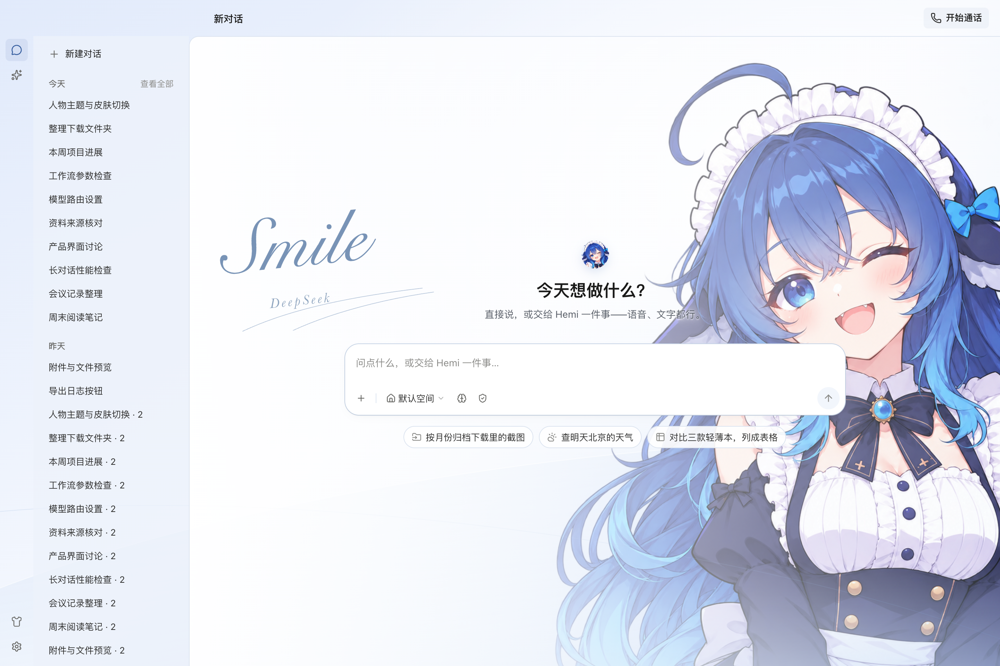

# 主页人物主题视觉稿 v1

日期：2026-10-21。用户最新参考明确采用“右侧大幅人物、左侧少量主题文字”的构图。这里将人物作为主页的主要视觉，并延续启动样片的浅蓝场景；替代本轮最初把大幅人物仅作为浅水印的尝试。产品布局仍沿用当前 Hemi，不重新设计侧栏、字体体系、输入框或任务卡。

打开 [预览页](index.html) 可切换主页和会话阅读两张静态效果图。

人物局部动画已合成到[主页动态整体预览](../home-background-motion-v1/index.html)，沿用这里的构图和界面样式。

| 区域 / 状态 | 处理方式 |
| --- | --- |
| 主页右侧 | 使用晴海蓝透明人物，以清晰大图占据右侧，头部与五官为主要构图锚点；背景固定，不承接点击 |
| 主页左侧 | 沿用用户原图的 `Smile` / `DeepSeek`；主词采用舒展的手写题字，整体轻斜，名称以小号衬线斜体错位排列，细弧线作收笔；不另写口号 |
| 欢迎与输入 | 现有欢迎语、头像位置、输入框、建议任务保持原布局；输入框实色白底 |
| 会话阅读 | 收起左侧装饰文字，增加阅读区白色遮盖度，人物退为右侧淡背景；正文和代码沿用当前样式 |
| 会话列表 | 50 条演示会话，保持原高度与滚动范围；设置上方沿用换肤图标位置 |
| 窄窗 | 主题文字缩小并移至上方留白，人物安全裁切、降低强度，输入与导航保持原响应式布局 |

这套构图随皮肤应用，不增加人物背景开关。图中装饰文字属于主题物料，不代表当前所选模型、模型状态或可点击功能。预览页是两张效果图的切换器，产品内换肤入口尚未实现。

## 原图文案映射

| 皮肤 | 大字 | 配套名称 |
| --- | --- | --- |
| 晴海蓝 | Smile | DeepSeek |
| 月见紫 | Sister | GPT |
| 焦糖橙 | Suspended | Claude |
| 蜜糖金 | Sweet | Grok |
| 围巾红 | Stupid | Doubao |
| 经典 | 无人物主题文案 | 无 |

保留原图英文拼写和大小写。浮层内仍用已确认的中文皮肤名；这里的英文属于背景视觉，不改变用户选择的服务或模型。映射记录于[物料清单](../v1/manifest.json)的 `backgroundCopy`；长词按可用区域缩字号，保持单行并避开欢迎语与输入区。

本轮艺术字打样只调整背景装饰，产品正文和控件字体保持原样。当前预览调用 macOS 本机的 Snell Roundhand 与 Baskerville，未复制或分发字体文件；正式跨平台物料需要准备可分发的字体或矢量字形，以保证相同表现。

## 来源与验证

- [构图参考](composition-reference.png)：用户在本轮提供的截图，原样归档，仅作为视觉参考。
- 人物：[晴海蓝母版](../v1/masters/cafe-blue.png) 与 [头像裁切](../v1/portraits/cafe-blue.png)。源图未用程序修图。
- [preview.css](preview.css)：叠加在实际 Hemi renderer 上的打样样式。渐变、光带和装饰文字由 CSS 排版。
- [qa.json](qa.json)：记录 commit、环境、命令与剩余缺口。在 1440×960、980×760、560×760 验证无横向溢出；1440px 版的原有控件几何、字体、圆角、文字和列表容量与应用前一致，50 条会话滚动时背景固定，滚至末尾的 24 个完整可见会话中心仍命中原按钮。

本轮只交付视觉稿，未改生产主题代码，未验证真实冷启动、IPC、保存、多窗口或构建 renderer。六款主题的最终合成对比度及正式背景导出仍需开发验收。截图中的会话与“测试通过”等正文来自 fixture，只用于检查排版，不是本次功能的验证结论。
