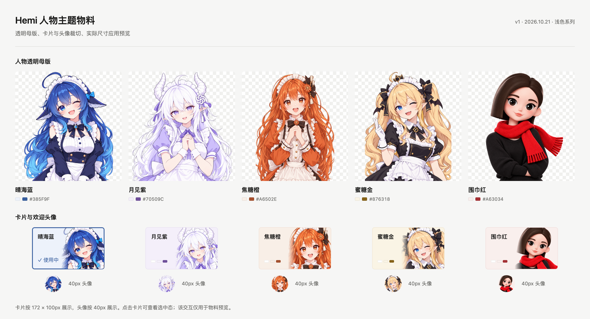

# Hemi 人物主题物料包 v1

日期：2026-10-21。配套：[产品需求](../../../requirements/appearance-and-skins.md)、[技术方案](../../../technical/appearance-and-skins.md)。

新增：[晴海蓝 6 秒启动动效预演](../motion-preview-v1/README.md)，包含可播放 MP4 与可拖动进度的网页版本。

新增：[主页背景视觉稿](../home-background-v1/README.md)，采用右侧人物、左侧原图英文大字与名称；五款文案映射已补入 manifest 的 backgroundCopy。

最新：[冷启动与主页两段动效预演 v2](../motion-preview-v2/README.md)，包含连续交接与会话阅读静态状态。人物完整表情和关节动画尚需制作素材。

包含五款人物的透明母版、卡片与头像共用裁切、六款起始配色、使用参数和检查记录。保留人物各自的画风；橙色已正向，海报文字已移除。经典使用现有 Hemi 标记。

[查看完整检查图](materials-overview.png)，包含白/深灰底透明边缘及侧栏叠字。[交互预览](preview.html) 可用浏览器直接打开，不需要服务端或联网。深灰底仅作透明边缘检查，不代表交付深色主题。

## 1 文件清单

| 皮肤 | 透明母版 | 卡片与头像共用裁切 | 母版尺寸 | 裁切尺寸 |
| --- | --- | --- | --- | --- |
| 晴海蓝 | [PNG](masters/cafe-blue.png) | [PNG](portraits/cafe-blue.png) | 1135×1386 | 1254×1254 |
| 月见紫 | [PNG](masters/cafe-purple.png) | [PNG](portraits/cafe-purple.png) | 1197×1314 | 1254×1254 |
| 焦糖橙 | [PNG](masters/cafe-orange.png) | [PNG](portraits/cafe-orange.png) | 1060×1484 | 1254×1254 |
| 蜜糖金 | [PNG](masters/cafe-gold.png) | [PNG](portraits/cafe-gold.png) | 1114×1412 | 1254×1254 |
| 围巾红 | [PNG](masters/cafe-red.png) | [PNG](portraits/cafe-red.png) | 1110×1417 | 1254×1254 |

- [manifest.json](manifest.json)：六款顺序、配色、源图尺寸/字节/hash、alpha 信息与使用参数。
- [generation-prompts.json](generation-prompts.json)：完整生成提示词、参考和工具模式。
- [classic.svg](classic.svg)：现有 Hemi 标记的原样副本，沿用原资源声明。
- [image-checks.json](image-checks.json)：10 张 PNG 的只读元数据与透明检查。
- [preview-checks.json](preview-checks.json)：物料预览尺寸、选择反馈、窄宽度与运行错误检查。

## 2 使用约定

| 用途 | 来源与参数 |
| --- | --- |
| 侧栏背景 | 使用 master；基准宽 270px、right −20px、bottom 16px、opacity 13%，上下渐隐；定位到侧栏容器底层，列表在上方滚动 |
| 皮肤卡片 | 使用 portrait；人物槽位 102×100px，约 1.22 倍显示并从左侧渐隐，名称和状态留在左侧 |
| 欢迎头像 | 使用同一 portrait，40px 展示，约 1.18 倍、锚点 50% 58%；保留现有欢迎布局 |
| 经典 | 使用原有标记和颜色，无人物背景 |

卡片与头像共用一份裁切来源，不各自重新画脸。预览页的卡片宽 172px 便于物料比较，产品实际卡片宽度由 392px 浮层及既有内边距计算；高度、人物槽位和字号按需求还原。背景不提供独立开关，不与模型或人格绑定。

## 3 配色与工程导出

manifest 中的 palette 为确认稿扩展出的起始颜色，包含独立的成功、运行、警告、危险语义。它不替代后续完整 token 迁移和全页面对比度验收。字体、间距和圆角不由物料包修改。

当前 PNG 是保留清晰度的设计源图，适合继续裁切、编码与核对；生产资源按技术方案离线导出侧栏 540px 宽、卡片约 256px、头像 96px 三档。不要在 40px 头像处常驻解码全尺寸母版，也不要在切换时在线生成或下载图片。

## 4 生成来源

采用内置 image_gen，透明背景模式；未使用 CLI。蓝色母版沿用前一轮确认效果所用图，另外四张母版由用户人物海报提取，五张 portrait 以对应母版作为编辑输入。完整提示词与约束见 generation-prompts.json。原始人物参考与适用来源信息保留在[需求附件](../../../requirements/assets/appearance-and-skins/SOURCES.md)。

PNG 按工具输出原样保存，未用程序修图、抠图或改像素。预览使用 HTML/CSS 排版和浏览器截图；PNG 元数据检查只读取像素与 alpha。母版边缘的外延头发可由侧栏裁切，人物头部和五官须在实际使用尺寸下可辨。

## 5 当前检查范围

10 张图均为 RGBA，具备真正透明区域和足够的近不透明人物区域；5 张 portrait 均为 1254×1254。已检查 40px 头像、100px 高卡片、白/深灰底和列表叠字。预览在 1400、980、560、375px 宽下无横向溢出，未出现运行异常。

检查基线：`e556f9844e2d3e50c0c789ed2a29c22d08ba6b27` 加当前工作树；Node.js v22.22.3、macOS arm64、Chrome 155.0.8059.85，1400px 宽、2× 截图。原型脚本为本地 `node tmp/render-skin-materials.mjs`；只验证物料预览，不代表生产换肤、首帧、IPC 或完整主题对比度通过。

产品布局仍以需求中的第三稿为准；本轮更换为无字人物物料，未接入生产应用。
