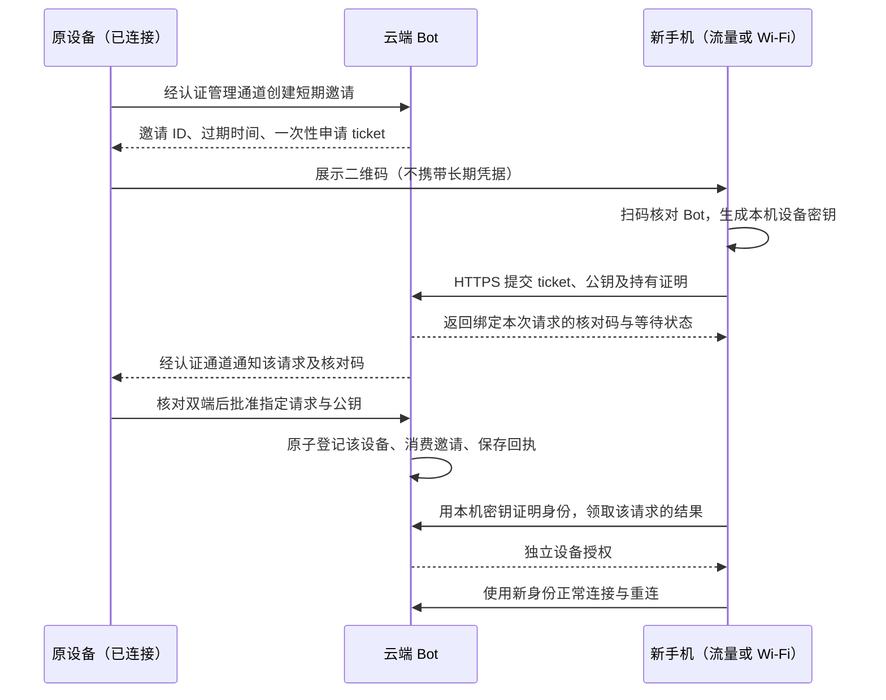

# Bot 自有设备扫码配对需求与方案

2026-10-23。用户已确认：连接自己的新设备，手机使用流量也应能连接云端 Bot。支持跨网络，不要求两台设备处于同一局域网。本文件记录产品规则；本轮已实现 Bot 内置 TLS 网关、PC 真实二维码／人工确认／撤销和 iOS 原生扫码／Keychain／设备签名客户端。支持 IP 与二维码固定证书，无需域名或中间服务；服务器端口仍需管理员放行。部署与协议见 [技术说明](../../technical/bot-device-pairing.md)，验收边界见 [实施记录](../../technical/mobile-app-implementation.md)。

## 产品决定

使用“短期、一次性的配对邀请”，并要求已有可信设备明确确认。二维码授予的只是提交配对申请的资格，不是 Bot 登录权限；不能采用“谁先扫码，谁就自动获得权限”。一次性指成功登记一台设备，之后设备使用自己的身份正常连接，直到单独撤销。

推荐把配对授权模块放入现有云端 Bot，通过可达的 HTTPS 入口处理新设备申请；已有设备继续通过认证管理通道确认。无需额外部署 Hemi 中央账号系统或流量中转服务器，但必须扩展目前只有 SSH 的 Bot。手机的流量／Wi-Fi 网络都需要能访问该配对地址及后续连接端口。

首版只连接自有设备。多人共享、按用户隔离会话与只读权限不在本轮范围。允许连接时应明确：设备可查看 Bot 对话、读取文件，并通过 Bot 执行服务器账号权限内的任务。

## 社区做法与选型

查阅日期：2026-10-23，仅依据项目官方文档，不把某一个项目的策略当成通用安全标准。

| 代表实现 | 服务职责 | 对 Hemi 的启发 |
| --- | --- | --- |
| OpenClaw Gateway | Gateway 内部生成短期 bootstrap 凭据，处理配对及设备身份；手机连接 Gateway。部分官方移动扫码路径自动批准，不能等同于 Hemi 的人工确认规则。 | 借鉴内置网关、临时邀请与长期设备身份分离；Hemi 保留原设备核对和明确允许。 |
| Tailscale／Headscale | 单独的控制服务协调设备、密钥分发与网络连接；Headscale 是自托管的 Tailscale 控制服务实现。 | Bot 没有直接可达地址时可作为组网选择；网络准入仍不能代替 Bot 自身配对授权。 |
| Syncthing Relay | 直连失败时转发设备之间的加密流量。 | 中继解决网络可达性，不是防二维码外泄的授权步骤；云端 Bot 可直连时不必引入。 |

来源：[OpenClaw QR](https://docs.openclaw.ai/cli/qr)、[OpenClaw 配对](https://docs.openclaw.ai/pairing)、[OpenClaw 设备协议](https://docs.openclaw.ai/gateway/protocol/rpc-devices-nodes-and-approvals)、[Tailscale 控制与数据通道](https://tailscale.com/docs/concepts/control-data-planes)、[Headscale](https://headscale.net/)、[Syncthing 中继](https://docs.syncthing.net/users/relaying.html)。

这些项目的过期时间、权限与自动批准策略不直接照搬。Hemi 选择 120 秒邀请和明确人工确认，是针对二维码外泄风险的产品决定。

## 配对流程

原设备与新设备都连接 Bot，不互相建立局域网连接。只要新设备能够访问云端入口，就不需要两台设备同网，也不需要原设备监听端口。原设备必须能在邀请有效期内重新连上 Bot 完成确认；离线时不允许自动跳过。

配对服务仅对未配对客户端提供“申请自己的请求、查询自己的状态、完成已批准登记”等受限接口。未确认设备不能访问对话、文件、执行命令、订阅其他设备事件或调用管理 RPC。当前手机会话使用设备签名的 HTTPS 白名单 RPC；PC 管理继续使用 SSH，未将任意 Unix socket RPC 直接公开。

## 链接和二维码载荷

优先在 Hemi 应用内扫码解析版本化结构，不把邀请码做成普通网页自动登录链接，也不引入公共短链接服务。二维码可以包含以下字段：

| 字段 | 含义 |
| --- | --- |
| `version`、`inviteId` | 协议版本与非秘密邀请标识。 |
| `endpoint`、`botInstanceId` | Bot 的 HTTPS 配对地址与实例身份；扫码后先展示目标，再允许发送申请。 |
| `requestTicket` | 至少 256 位 CSPRNG 产生的随机秘密，仅可用于本次邀请申请。Bot 保存不可直接还原的校验值，明文不落日志。 |
| `expiresAt` | 展示过期时间，最终由 Bot 的时钟和状态判断，不信任客户端修改。 |
| `certificatePin` | 必填的 SHA-256 DER 证书指纹，经 PC 的可信 SSH 通道取得；新设备按此限定信任并执行原生 TLS 校验。 |

不包含 SSH 私钥、SSH 密码、原设备长期令牌、模型密钥或能直接操作 Bot 的长期凭据。ticket 仅在本次配对期间临时保留，通过 HTTPS 请求体提交，不进入普通 URL 查询参数、代理访问日志、分析上报或崩溃日志。

必须校验载荷长度、字段、版本、HTTPS 地址和重定向目标，禁止把二维码作为可执行 URL／命令。系统深链接如后续开放，需要额外验证来源与平台关联，不能仅因使用自定义 scheme 就认为安全。公网入口使用正确 TLS 校验；当前自托管实现使用确切证书固定，并继续校验 SAN、有效期和 serverAuth 用途，不降低为任意证书或明文通信。

## 一次性的准确语义

1. **创建**：Bot 记录签发者、过期时间和邀请状态；默认 120 秒，不允许扫码方自行续期。
2. **申请**：新设备提交公钥、随机请求标识及密钥持有证明，Bot 绑定一个具体请求。申请不会直接获得任何会话权限。
3. **核对**：两端通过各自可信通道读取绑定邀请、请求、新设备公钥、Bot 实例和服务端随机量的核对结果。名称由客户端提供，只作显示；核对码不能是新设备随意自报的值。使用经审查的实现，不自行拼接加密握手。
4. **批准**：原设备批准具体 `inviteId + requestId + devicePublicKey + operationId`。Bot 在同一原子操作内检查邀请未过期／取消／消费，登记一个设备、将邀请标记为已使用并写入回执。
5. **完成**：只有对应设备私钥的持有者可领取自己的授权结果；仅持有旧二维码或轮询标识的人不能截取已批准设备的身份。
6. **重试**：请求或结果丢失时核对原请求／操作回执，不重复批准，也不把已消费邀请重新开放。成功消费但结果交付不明确时显示“待核对”，不是“可以重新扫码再授权”。

扫码本身不代表授权成功。也不依赖“扫码立即销毁”来防泄露：攻击者可能先扫码造成占用，因此仍需原设备核对、拒绝和重新生成的路径。首版一次只展示一个明确绑定的请求，不静默替换当前请求，不自动批准第一个到达者。

邀请消费后失效与设备授权撤销是两件事：邀请码过期不应使已配对手机每次重连都重新扫码；发现陌生设备时，从设备列表撤销该设备。

## 外泄、取消与撤销

| 情况 | 处理 |
| --- | --- |
| 二维码在有效期内泄露 | 最多被用于提交待确认请求，不能直接查看历史或执行任务；原设备必须对比自己新手机的验证码，不能只相信设备名称。仍可能产生申请骚扰或占用，需限流与取消重建。 |
| 暴力尝试／并发抢扫 | 按实例、来源和邀请限制请求速率、数量与大小；一次只批准明确绑定的请求，原子消费防止第二台设备复用。 |
| 原设备拒绝／重新生成 | Bot 作废旧邀请及其待处理申请；旧二维码不能再次授权。 |
| 关闭配对页 | 未扫码邀请明确向 Bot 请求取消；已经收到的待确认请求只收起详情，不隐式拒绝。断线取消回执未知时隐藏旧码、显示待核对，不假称服务器已撤销；服务端到期后拒绝未完成登记。 |
| 原设备离线 | 不进行批准；新设备继续等待至截止时间，或由用户取消。原设备恢复后先核对状态，不自动重放同意操作。 |
| 设备已配对 | 单独撤销其身份，终止已建立的受控通道，拒绝后续 RPC 与文件读取；保留其他设备和已受理云端任务。 |
| 已缓存的数据 | 无法远程收回，不承诺撤销等于抹除历史或回滚已经执行的命令。 |

不默认提供保存二维码到相册、系统分享或永久链接复制。截图无法彻底阻止，应按二维码可能外泄来设计，而不是承诺“二维码不会被泄露”。

## 已实施的连接边界

原有 `transport.mjs` 严格核对 SSH 主机密钥，CLI 通过 0600 Unix socket 调用 Host。本轮保留此可信管理通道，并将 `device-gateway.mjs` 加入现有 Bot：默认关闭，经明确启用后监听受限 TLS 入口。手机不会拿到 PC 的 SSH 凭据，也不直接连接 Unix socket。

- 120 秒单次邀请、单个绑定申请、服务端核对码、精确人工批准、独立设备表及原子登记／回执已实现。
- `jose` 验证 ES256 设备证明，绑定 Bot、路由、确切请求体和单次 nonce；限流、请求大小及超时受限。
- iOS 使用原生相机、CryptoKit、Keychain 和 URLSession；私钥留在原生层。固定二维码证书指纹后仍执行原生 SSL 身份校验。
- 每次设备 RPC 核对身份；撤销销毁已跟踪连接并拒绝后续请求。未知管理／发送结果查询原回执，不自动重放。
- 主机、实例、证书变化和旧 Bot 不支持时明确报错；原生 SSH 回退、Android 原生适配、附件上传和推送未包含。

当前 Bot 执行权限与控制数据处在同一服务器用户权限域。受限入口不能隔离 Bot 工具本身的命令执行能力；不能声称可清除已授权恶意设备留下的改动。未来给其他人受限使用，必须另行设计独立账号／沙箱等控制面保护。

## 多端职责与服务选择

配对属于 Bot 连接层，不放入对话 SDK 的消息／草稿／排队核心。多端共用状态与协议适配，原生宿主分别注入扫码、安全存储、设备签名及连接能力；不再要求原设备提供局域网接收服务。

| 建议 API | 职责 |
| --- | --- |
| `pairing.create({botId})` | 通过已认证管理通道让 Bot 签发邀请，返回 QR 载荷及权威截止时间。 |
| `pairing.scan()` | 相机识别、严格解析并展示目标预览，不自动授权。 |
| `pairing.request({invite,devicePublicKey,proof})` | 向云端入口提交本机申请，取得绑定请求的状态与核对信息。 |
| `pairing.approve({inviteId,requestId,operationId})` | 原设备明确核对、必要的系统验证后，由 Bot 原子登记指定公钥。 |
| `pairing.cancel/status` | 服务端取消或核对不明确的邀请／操作结果，不能仅清除前端状态。 |
| `devices.list/revoke` | 以 Bot 返回为准，支持单独撤销设备和核对回执。 |

直接可达的云端 Bot 优先使用内置配对模块，不引入独立中央中间服务。若某些部署只有私网或位于 NAT 后，再评估组网／隧道／中继；这些服务解决可达性，不能替代本节的设备授权规则。支持公网 HTTPS 的域名、证书和网络配置属于真实接入工作，当前不会自动替用户开放端口。

## PC 端交互配套

PC 为已连接可信设备时，同样承担签发和确认职责。入口沿用 Bot 页右上角设置，在现有弹窗内增加设备区，不新增一套独立账号设置。

- “连接新设备”：居中弹窗展示一次性邀请、Bot 目标与截止时间，支持取消。等待扫码时关闭需取消邀请；取消回执未知则隐藏旧码并等待核对。
- “新设备请求”：顶部非阻断提示，保留当前对话与草稿。打开后核对双方代码再允许或拒绝；收起详情保留待处理请求，不隐式拒绝或批准。
- “已连接设备”：显示已登记的手机设备和最近连接；PC 继续通过 SSH 管理，不伪造为手机设备行；批准后先标记等待首次连接，不把登记成功当成手机已连接。
- “撤销访问”：确认目标与影响，收到 Bot 回执后更新；回执丢失时保留条目并标明待核对。
- 断线、旧 Bot 不支持和缺少管理能力必须给出原因，不能只生成一个无法完成安全配对的二维码。

可点击 PC 稿及逐项状态见 [PC 交互说明](v1/DESKTOP.md)。正式 PC 已在 Bot 顶栏、设置以及已绑定但暂无会话的页面提供“连接新设备”，并接入真实入口配置、QR、双端核对、批准／拒绝、设备列表与撤销。旧 Bot 可执行实际组件维护，PC 断线时禁止签发与批准并隐藏旧码。

实际 Electron/preload/IPC/CLI/socket/Host、真实 QR 解码、生产 Swift 签名／TLS 与撤销验证已覆盖开发和构建页面。SSH 网络边界、模型执行与 macOS 集成测试的凭据存储为替身；设备相机、Keychain、公网部署的状态以 [实施记录](../../technical/mobile-app-implementation.md) 为准。

## 交互稿与验收边界

交互稿保持紧凑字体和既定布局，新增扫码、生成、原设备确认与设备列表。页面明确手机可用流量或 Wi-Fi；原设备核对和到期／拒绝状态仍保留。

`v1/pairing-demo.png` 只编码 `hemi-demo://pairing?v=1&fixture=not-a-credential`，由 Core Image 生成并回读核对。演示使用本机 reducer，不调用相机、不发真实配对请求，也不登记或撤销服务器权限。QR 中无可用凭据。

当前自动化已覆盖 TLS 指纹错误、未批准拒绝访问、过期／重放／并发批准、设备持有证明、回执丢失恢复、撤销／重启与实际会话读写。仍需按真实部署补齐公网跨网、相机、Keychain、后台／锁屏恢复、真实模型与文件业务验收，以及服务器命令权限对控制面的影响；不能用交互稿或 macOS 测试替代这些结果。

双端核对策略另参考 [RFC 8628 §5.4](https://www.rfc-editor.org/rfc/rfc8628.html#section-5.4)。本方案不是直接实现 OAuth Device Grant，也不要求引入独立 OAuth 账号服务器。
