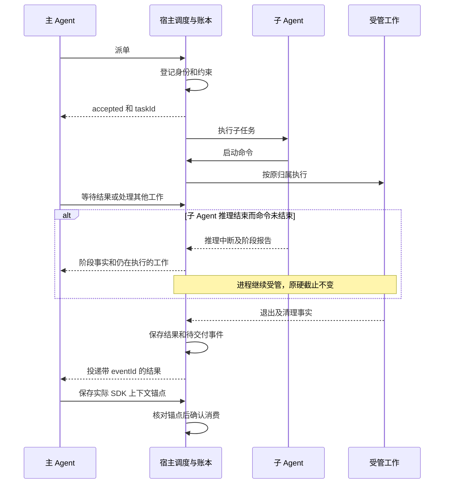

# Agent 与后台任务生命周期候选方案

状态：待 review，未批准实施。对应[行为需求](agent-task-lifecycle.md) v0.2；Hemi 源码基线为 `e7996fcdf91fd29bfc6e54d208bd7fcd10dfa978`。

这轮 Codex 与 CC 的建议是：宿主负责工作的身份、约束、结果和清理，Agent 在授权及预算内判断下一步。主 Agent 没有输出时，仍能从宿主获得真实等待原因；子 Agent 推理结束时，它启动的进程仍有明确负责人。

优先解决前台子任务与父级额度交接互相等待的问题，同时保留正常长任务跨调度边界、取消不重放、结果不丢和异常收尾等历史保证。具体超时数值和下述产品选择仍按需求 D 项评审。

## 四类事实分别记录

| 事实 | 例子 | 负责者 |
| --- | --- | --- |
| 推理状态 | 子 Agent 正在请求模型、等待工具、已因模型错误结束推理 | Agent 执行管理器 |
| 工作状态 | 命令仍在跑、已退出但输出未收完、清理未确认 | 宿主的受管工作控制器 |
| 结果交付 | 报告可读、待写入主 Agent 上下文、上下文已保存并确认 | 结果存储与事件账本 |
| 目标状态 | 执行中、等待用户、部分完成、失败、取消、完成 | 根目标调度及完成校验 |

子 Agent 报错，但下载进程仍在执行，可以表现为“推理已中断；工作仍执行；阶段报告可读；目标未结束”。不能用一个 terminal 状态同时表达四件事。结果是否完整、保存是否确认、清理是否确认还应作为各自事实保留，不能全部压成 unknown。

## 派单与结果交付

推荐子任务受理后统一真实返回 `accepted + taskId`，主 Agent 可处理独立工作或进入宿主等待；主 Agent 不需要持续请求模型来维持等待。所有结果沿一条持久交付路径进入主 Agent 上下文，减少“同步返回／转后台”同时完成时的竞态。子任务不再等待“正等自己返回的父级”推进额度。

采用这一路径时，所有已受理派单的结算事实都写入结果存储及 inbox，不能再由 `background` 或 `stopRequested` 决定是否产生事件。根目标仍有效时，单条停止结果也要交付；根目标已失效时保存结果、将事件标为不再唤醒。当前 `core.mjs` 的 `onSettled` 及 `journal.completeTask` 仍按后台标志决定 inbox，必须一起修改；只改 accepted 返回值会丢失前台结果。

保留短同步返回仍是备选。统一 accepted 可能增加模型请求与结果往返，须在普通回合、目标回合及工作流中测量；如果成本或兼容性不可接受，回到 D-01 评审。不能先假设真实 SDK 已支持所有取消和续接时序。



交付顺序为：保存结果与待交付事件 → 读取或领取 → 写入带 eventId 的实际上下文 → 保存上下文 → 核对锚点 → 确认消费。只读取报告或准备返回工具结果都不算最后一步。

若上下文未保存，保留待交付事件；若上下文已保存而确认失败，重试时按 eventId 查锚点，只补确认。可重复传送事件，不能重复执行原任务。执行代次失效后，事件不再唤醒模型，但已保存的结果仍可查阅。阶段报告与后续工作结果须有不同的稳定事件身份，不能后到结果被第一次确认吞掉。

## 时间与预算边界

| 边界 | 到点含义 | 推荐处理 |
| --- | --- | --- |
| 同步等候期限 | 调用者不再继续等 | 返回真实受理状态，真实工作不受影响；统一 accepted 时无需该派单等待 |
| 静默观察点 | 缺少新输出，需要观察 | 保留现有有界核验；没有证据时说明进展未确认 |
| 启动时声明的检查点 | 到预计时间，应核对工作 | 与输出量无关；在原硬截止内进行有界核验，继续等待不会刷新硬截止 |
| 单项硬截止 | 该工作项的执行授权到界 | 停止该项、保存 timed-out 与清理事实；其他必要工作按原授权继续 |
| 软复盘点 | 调度器需要重新核对目标 | 只记录复盘提示，不设置硬限额标志、不拒绝请求或工具、不强制子任务结算 |
| 请求准入关闭 | 总预算或可选子额度禁止相应范围的新请求／动作 | 原子拒绝新准入，记录在途请求的真实终态；本事件本身不等于所有进程停止 |
| 根目标终止 | 用户停止，或适用政策要求收口 | 关闭新动作入口，保存能确认的事实，取消在途并核对清理，给出基础反馈 |

每项约束在受理时记录来源、范围和到点动作。现有命令 `timeout_ms` 是硬语义，不能在到期时追溯改成软提示。推荐保留它的现有语义，为长任务在启动时声明合适的授权范围及检查点。默认值仍待 D-02／03，不能将工程默认称为用户明确要求。

检查点已到但工作尚未完成：在原硬截止内核验。可确认仍有必要工作时继续；没有证据或模型暂不可用时，记录进展未知并在剩余授权内等待；到真正硬截止执行预先声明的动作。若确需新增授权，必须在执行前形成明确契约，不能靠模型判断“还正常”自动延长，也不能重置累计预算。

静默核验和检查点共用有界观察资源，避免叠加两个模型轮询循环。重复日志不能推迟检查点；现有静默检查仍只检测静默。检查额度用完时，明确展示“仍有工作，进展未确认，自动核验额度已用完”；保存待处理事实，保留人工检查和停止能力，之后等待实际事件或硬边界，不继续空转。

共享调度分段不应让子任务等待祖先。推荐将保留的段边界真正改成软复盘：不再进入现有 `requestStart` 的每段拒绝分支，不设置 `requestLimitReached`，不触发 `assertExecuting` 拒绝新工具，也不使子任务自动变成 partial。根调度在安全的回合边界处理复盘提示，不要求必要进程先退出。这是需要评审的契约变更，不能仅把当前每段硬闸门改名为“软”。

可选子额度与目标总预算仍是各自范围的硬准入约束；是否保留独立子额度仅影响分配策略。请求总额度若按政策要求终止目标，应显式转为根目标终止事件。推荐本阶段保留现有“总预算收口清理目标树”的契约；允许预算用尽后继续执行须另按 D-06 评审。基础反馈不依赖额外模型请求。

## 子 Agent 失败后的工作控制

推荐在根目标仍有效时，子 Agent 模型失败只结束该次推理，健康进程由宿主继续管理到自身结束或适用的停止边界。原 owner 保持不变；同一会话、同一根目标及执行代次的祖先，可经验证权限读取和停止后代工作。子任务阶段报告列出仍在运行的工作及快照时间。

控制器的生存期必须覆盖真实工作，不随 Pi 会话淘汰而消失。不要求保留整份模型会话，但不能只删一处 modelError 分支里的 abort：根层 catch、子任务结算、工作流释放、会话复用和 dispose 都须统一遵守该规则。报告已投递也不代表进程无人管理或目标可完成。

根调度在完成校验前，须查询整棵根目标下的必要工作，包括已结束推理的子任务所持有的 job。仍有工作时进入有明确对象的宿主等待，界面一行显示等待哪些命令及进展是否确认。等待由根调度订阅宿主工作事件，不能依赖根 Pi 会话只能看见自己命令的局部列表；基本等待不发模型请求。

解除等待的条件是工作结算、适用硬边界、用户或根目标停止，或无法确认执行而进入有界收口／隔离。工作结束时保存结果并唤醒后续决策；清理未知不能继续无限等。原 `checkGoal` 对未结束工作的严格拒绝保留，调度器应在调用它之前完成上述等待或按事实收口，不能让“正常等待后代工作”直接变成 `goal-execution-unconfirmed`。P-03 同时验证这条根等待路径。

本推荐仅覆盖根目标仍有效的情况。根模型恢复最终失败时，本阶段仍按现有目标失败流程清理全部受管工作、保留成果；若要把工作交给用户继续跑，需要额外的受理和接手契约。根目标终止前，先冻结新准入并尽量保存工作清单，保存故障不能无限阻塞取消；取消与清理确认分别记录。

监督逻辑位于模型与 SDK 的等待之外，按账本事件驱动，不依赖模型主动 check 或前台工具先返回。它不能用丢弃 Promise、伪造工具返回来结束 SDK 回合。同一宿主线程的监督者仍无法保证检测该线程完全停摆；外部观察者属于 D-08 的独立决定。

## 边界处理与兜底

| 情况 | 推荐处理 | 决策失败或事实不确定时 |
| --- | --- | --- |
| 正常静默，未到检查点 | 展示暂无新输出；按已声明策略等待和有界观察 | 保持进展未确认；不因静默重跑或判失败 |
| 预计时间已过，进程仍正常 | 原硬边界内核验必要性并继续 | 核验不可用则在剩余授权内等，到真实硬边界按契约处理 |
| 重复日志或黑盒任务 | 核对与目标有关的产物／阶段证据；检查点不被日志刷新 | 无证据则进展未知；不能声称通用识别卡死 |
| 业务已完成，连接不退出 | 保留既有读取、核验与单条停止能力 | 硬截止仍有效；清理未知则隔离实际冲突范围 |
| 子模型报错，命令仍执行 | 阶段报告与执行事实分别保存；宿主管理，祖先按权限接手 | 根目标终止时按目标政策收口；不以保留进程隐式授权常驻服务 |
| 子任务跨软复盘点 | 只记录提示，不截断请求／工具、不强制报告未完成，也不等祖先 | 硬总预算仍生效，软提示不能刷新授权或开启隐式无限执行 |
| 子任务触及可选独立额度 | 结束其新增准入并报告未完成，已受理工作按原授权受管 | 父级无法继续时仍有宿主状态及硬边界；额度不足不记完成 |
| 父模型暂不可用，子结果已就绪 | 保存结果，沿现有单一请求恢复策略处理 | 恢复失败后目标按政策失败并清理，成果仍可查，不重做工作 |
| 工具报错，或退出 0 但目标未完成 | 返回真实证据，保留严格完成校验 | 无法推进依事实收口为部分完成、受阻或失败；校验异常不假完成 |
| 请求或目标额度到限 | 区分准入关闭与目标终止；禁止隐式额外请求 | 零模型反馈，保存剩余事项；在途用量和清理未知分别可见 |
| 等待用户登录或验证码 | 保留原目标、必要页面与累计预算 | 未答复不继续受限动作；适用硬约束按已决政策处理 |
| 停止与结果／重试竞态 | 先使执行代次失效；单条停止与根停止分别处理 | 迟到结果只保存，不唤醒新目标；不重放副作用 |
| 结果或终态写盘失败 | 保留执行栅栏；暂停自动派发先于释放忙碌槽，补存只写状态 | 显示保存未确认；不能承诺进程退出后仍保全未落盘数据 |
| 停止未确认或继承管道未关 | 有界核对进程身份、进程树及输出排空 | 清理未知，保留相应隔离；不误杀、不永久 stopping |
| 客户端断线、宿主重启或休眠 | 断线接回宿主事实；重启先按归属对账，旧输入不自动派发 | 模型恢复沿用绝对窗口；命令休眠口径待 D-11，事件循环停摆不宣称已有完整兜底 |

## 历史保证如何保留

| 需求依据 | 推荐负责边界 | 核对事件与场景 |
| --- | --- | --- |
| H-01 长任务跨分段 | 根调度、受管工作控制器 | 软分段不改 ID／开始时间／硬截止；S-01 至 S-03 |
| H-02 业务完成但连接未退 | 有界核验、输出读取和停止入口 | 保留核验机会；S-04、S-07 至 S-09 |
| H-03 保存失败可收尾 | 结果持久化、执行栅栏和队列 | 保存未确认不重执行业务；S-22、S-23 |
| H-04 唯一请求恢复所有者 | 既有模型请求恢复器与用量账本 | 同一绝对恢复期限；健康流可跨恢复窗口；S-14 至 S-17 |
| H-05 人工操作时保留浏览器 | 原目标与页面归属 | 等待用户不等于终态；S-24 |
| H-06 进程归属和清理证据 | 原进程守护、出生信息／随机标记／Windows Job | 退出、排空、保存、清理分别核对；S-10、S-21、S-26 |
| H-07 真实资源冲突 | 显式资源租约 | 不恢复目录锁，不强抢未知租约；S-30 |
| H-08 收口原因与续接 | 根目标状态及完成校验 | 不以输出文本判完成，续接不清预算；S-12、S-13、S-18、S-28 |
| H-09 结果不丢不重 | 持久事件与上下文锚点确认 | 取消等待、确认失败、阶段报告后续结果；S-19、S-27 |
| H-10 代次与重启栅栏 | 根目标、派单账本和重启对账 | 旧代次不再执行，队列暂停；S-20、S-25、S-26 |

旧的无条件“子会话等父级分段”规则应删除；软复盘从每段硬准入标志中分离。现有静默核验、模型恢复、进程清理、队列暂停和完成校验各保留原责任。前台交付分支若改为统一 accepted，须同时修改工具描述、全量结果入 inbox、结果消费入口、根目标等待后代工作、工作流映射及相应测试，不能只改 spawn 返回值。

## ZCode 与 DSH 的参考边界

本机只读源码对照为 ZCode `aac4755666d09fdcd70272fcf063c077a639015f` 和 DSH `d743267388641bc76f17c45ce8b4c231aed1d32c`，均未运行其回归；以下只说明参考结构。

| 项目及源码 | 可借鉴的结构 | 不能据此承诺 |
| --- | --- | --- |
| ZCode 的 `packages/core/src/tool/executor/background-tasks.ts`、`background-task-registry.ts` 及 `tool/handlers/task-output.ts`，位于 `apps/zcode-cli/` | 受管任务登记、快照／直接等待、独立输出读取与停止；没有观察源时标 lost；通知认领失败有释放路径 | TaskOutput 等待超时不等于执行超时；通知认领机制本身不能证明 Hemi 上下文已持久化，也不证明可通用识别无进展 |
| DSH 的 `packages/subagent/tool-subagent/src/index.ts` 及 `packages/subagent/subagent/src/manager.ts` | 派单返回子身份；管理器负责容量、归属、结算、释放及向原父级通知；结算检查待处理输入和后代 | 其最终 session flush 是 best-effort；不能把这当作 Hemi 的严格持久送达保证，也不照搬所有等待规则 |

## 实施前的探针

以下须使用真实共享核心与 Pi SDK，受控模型 HTTP 可用于稳定构造故障；不能仅凭 mocks 的返回断言认为链路成立。

| 探针 | 必须验证的边界 |
| --- | --- |
| P-01 派单停驻与交付 | 普通回合、目标回合、工作流中并行派单不提前完成；所有派单都写 inbox，含前台参数及单条停止结果；accepted 后能停驻并收报告；上下文保存前失败不提前确认，保存后确认失败不重复注入 |
| P-02 前台故障及取消 | 保留原 background:false 触顶死锁复现；替换后有真实工具结束；旧路径过渡期取消不会悬空，不借伪造返回收口 |
| P-03 子推理停止后仍有进程 | 根调度进入对后代必要工作的真实等待，不提前调用 checkGoal 报失败；会话淘汰、dispose、工作流释放后，控制器仍按已决政策可结算，祖先可读／停，后续结果不会被阶段报告吞掉 |
| P-04 并发额度 | 软复盘不设置硬限额标志，不拒绝请求／工具或强制 partial；硬额度下第 N 次在途、第 N+1 次被拒、同一响应多工具时准入／终态／记账正确；拒绝动作返回真实错误，不重放 |
| P-05 宿主监督 | SDK 正在等待工具时仍收到边界和取消事件；目标终止先阻止新动作，保存故障不能阻塞取消，清理未知可见 |
| P-06 检查点与输出 | 实际静默进程、持续刷日志进程均按所声明策略触发；不叠加观察配额，不刷新硬截止；模型核验不可用也有明确等待及收口 |
| P-07 休眠与到期竞态 | 依据 D-11 已决时钟规则，醒来时到期、进程结束、清理及保存竞态只有一份一致事实；完成校验不绕过未结束工作 |

## 验证记录

2026-10-29，macOS arm64、Node.js v22.22.3，Hemi `e7996fcdf91fd29bfc6e54d208bd7fcd10dfa978` 加本次文档及原有无关 renderer 工作树改动。现有基线回归：

```sh
node --test --test-concurrency=2 --test-reporter=spec \
  src/main/agent-runtime/background-handoff.test.mjs \
  src/main/agent/gate/background-job-controls.test.mjs \
  src/main/agent-runtime/model-recovery.test.mjs \
  src/main/agent-runtime/owned-processes.test.mjs
```

32 项通过，0 失败，0 跳过，约 5.9 秒。使用本地真实运行核心／Host／SDK 与受管命令，模型 HTTP 为受控响应；恢复窗口使用测试时钟，不是实等 30 分钟。没有验证线上供应商、Windows 实机、生产 Bot 或开发／构建 renderer。历史子任务交接测试为 background:true，不能证明前台死锁已修复。

本轮只改需求文档及导航；P-01 至 P-07 尚待实施阶段验证。CC 后续讨论因默认通道持续 503 使用原生 Claude Code 的 Sonnet 回退，没有修改运行时或模型配置。
