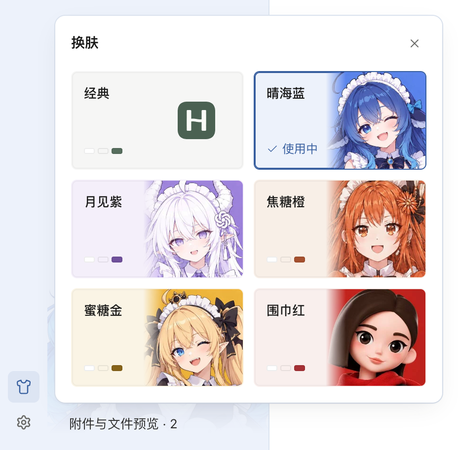
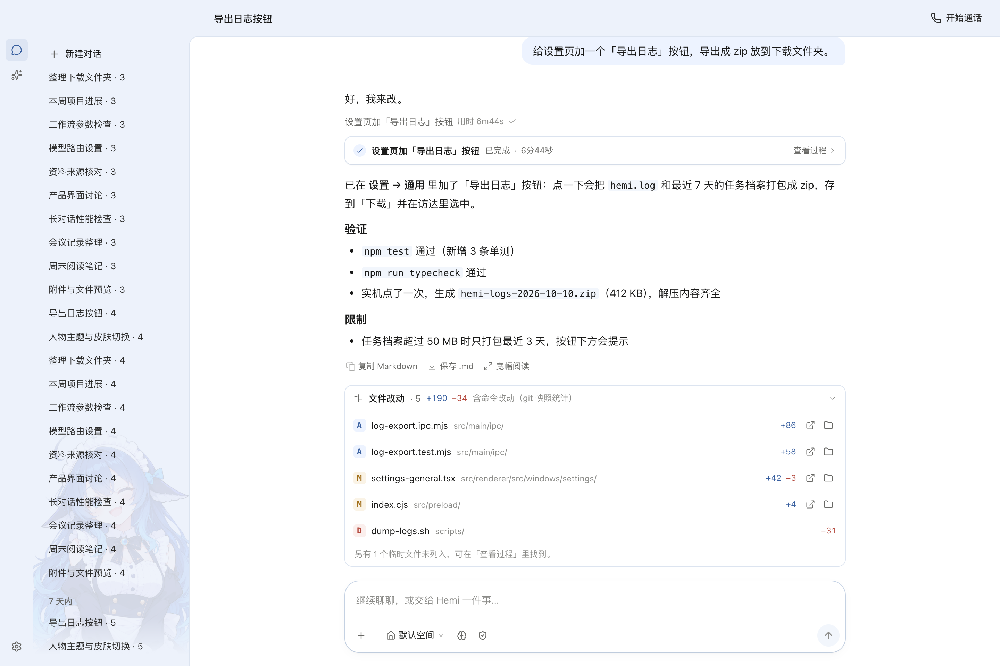
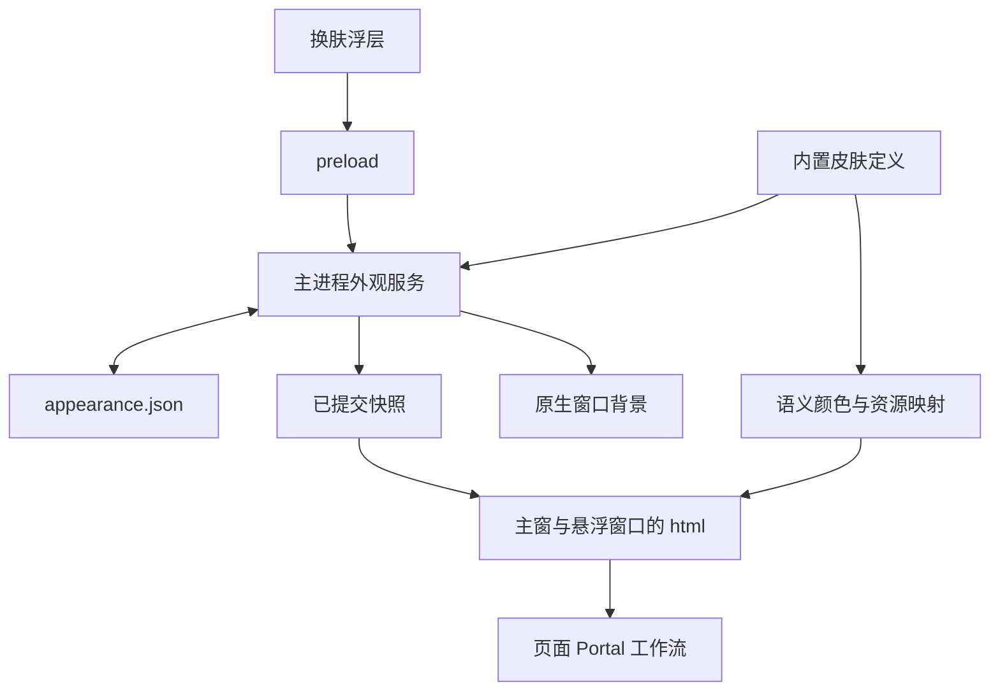

# Hemi 人物主题与换肤功能需求文档

| 项目 | 内容 |
| --- | --- |
| 版本 | 1.1，补充物料与技术方案 |
| 更新日期 | 2026-10-21（Asia/Shanghai） |
| 状态 | 视觉与交互方案已确认，待开发 |
| 适用产品 | Hemi 桌面端 |
| 需求范围 | 保留现有界面结构，增加经典与五款人物皮肤，以及全局切换和保存能力 |
| 视觉基准 | 本文第三稿效果图，无人物背景开关 |

本需求在 Hemi 现有样式上建立统一换肤能力。皮肤改变界面配色和人物装饰，保留现有布局、字体、间距、圆角与操作方式。用户通过设置按钮上方的换肤图标选择皮肤，所有 Hemi 自有界面同步更新，当前会话和正在进行的操作继续保留。

本文统一替代此前的调研草案和人物主题提案，作为本次开发与验收依据。文中的功能要求是交付目标，当前完成的是视觉原型。

配套交付：[人物物料包 v1](../design/appearance-skins/v1/README.md)、[换肤技术方案](../technical/appearance-and-skins.md)。物料和技术补充沿用已确认布局与交互，不增加人物背景开关。

## 1 目标与已确认方案

### 1.1 目标

1. 将外壳、对话、设置、工作流及悬浮窗口纳入同一套主题机制，支持后续继续扩展皮肤。
2. 基于用户提供的五位人物建立同一系列皮肤，通过配色与人物背景形成辨识度。
3. 让换肤操作直接、即时、可恢复，不打断阅读、输入、通话、任务或工作流编辑。

### 1.2 已确认的视觉和交互

| 决策 | 最终要求 |
| --- | --- |
| 与当前样式一致 | 沿用现有组件和页面结构，不借换肤改导航、重新排版或更换字体 |
| 换肤入口 | 左侧图标栏底部，设置按钮正上方，使用换肤图标 |
| 皮肤面板 | 两列、三行人物主题卡，包含经典与五款人物皮肤 |
| 卡片内容 | 左侧名称、右侧人物裁切、淡主题底色；经典卡使用 Hemi 标记 |
| 当前皮肤 | 主题色描边、勾选和“使用中”共同标识 |
| 切换方式 | 点击即应用并保存，面板保持打开，方便继续比较 |
| 人物位置 | 会话侧栏底层的固定淡背景，不占列表空间 |
| 会话列表满时 | 背景仍显示，列表在背景上方正常滚动和操作 |
| 人物背景开关 | 不提供；配色与人物随皮肤一起应用，切回经典后无人物背景 |

### 1.3 首版交付边界

为保持与确认稿一致，首版按浅色界面交付经典、晴海蓝、月见紫、焦糖橙、蜜糖金、围巾红六款皮肤。开发可以先用经典和晴海蓝打通链路，但两款完成不代表整个需求完成；完整交付须覆盖六款及本文验收范围。

补充落地规则：新装与升级首次引入外观配置时均默认经典，避免未经选择改变现有外观；已有合法选择继续保留。深色与跟随系统作为后续扩展，本版不显示尚未交付的模式控件。主题数据结构保留扩展余地，不要求本版制作额外的深色视觉稿。

## 2 确认效果图

### 2.1 换肤浮层



[查看完整界面效果](assets/appearance-and-skins/approved-full.png)。浮层正常态以第三稿为准：仅包含标题、关闭按钮和六张皮肤卡，不包含底部开关、分隔线、确认按钮或固定说明区。异常时可在内容区显示临时错误反馈，不恢复固定底栏。

### 2.2 会话列表铺满时



此图用于规定人物背景与长列表的层级关系。背景固定在侧栏内，文字与交互控件位于上层。不要通过减少列表高度、保留人物专用空白或按会话数量隐藏人物来实现。

截图来自当前 renderer 与演示数据，正文中的任务结果仅为 fixture 内容。图中人物裁切和色值是实现基准；正式资源需满足第 7 节的清晰度与可读性要求。

## 3 皮肤清单与视觉规则

### 3.1 六款皮肤

显示顺序固定为：第一行经典、晴海蓝；第二行月见紫、焦糖橙；第三行蜜糖金、围巾红。皮肤 ID 独立于供应商和模型，发布后保持稳定。

下表色值取自确认效果稿，用于还原初始视觉；不是完整 token 清单。交付时还须补齐正文、边界、焦点和业务状态等语义色，并通过对比度验收。

| 顺序 | 皮肤 ID | 显示名称 | 角色与配色方向 | 侧栏浅底 | 强调色 | 参考 |
| --- | --- | --- | --- | --- | --- | --- |
| 1 | `classic` | 经典 | Hemi 原有标记与现有浅色视觉，无人物背景 | `#F6F6F5` | `#566E5D` | 当前产品 |
| 2 | `cafe-blue` | 晴海蓝 | 蓝发人物，冷白、海蓝、深蓝配件 | `#EDF2FB` | `#385F9F` | [图 5](assets/appearance-and-skins/references/blue.jpg) |
| 3 | `cafe-purple` | 月见紫 | 白发人物，银白、薰衣草紫、缎带 | `#F4EFFA` | `#70509C` | [图 3](assets/appearance-and-skins/references/purple.jpg) |
| 4 | `cafe-orange` | 焦糖橙 | 橙发人物，奶油白、焦糖、深棕配件 | `#F8EFE7` | `#A6502E` | [图 2](assets/appearance-and-skins/references/orange.jpg) |
| 5 | `cafe-gold` | 蜜糖金 | 金发人物，蜜金、黑色蝴蝶结、金属细节 | `#FAF4E5` | `#876318` | [图 4](assets/appearance-and-skins/references/gold.jpg) |
| 6 | `cafe-red` | 围巾红 | 短发人物，红围巾、黑发、暖灰 | `#F9EFED` | `#A63034` | [图 1](assets/appearance-and-skins/references/red.jpg) |

经典必须等价保留当前外观，不能因共用主题服务改变原有控件几何或操作状态。上表仅摘录其预览配色；生产实现以迁移前的经典基线为准，不能用两个色值重建全部经典样式。

五张参考包含不同画风，沿用各自人物辨识度，通过统一的卡片尺寸、裁切位置和 UI 材质形成系列。参考图中的品牌字样、英文海报文字和性格标签不进入产品文案、系统提示词或模型配置。

### 3.2 保持不变的界面规则

- 顶栏、图标栏、会话栏、阅读列、输入框和现有断点保持不变。唯一新增的外部控件是换肤入口，可占用图标栏 spacer；设置按钮保持原位。
- 字体、字重、字号、间距、圆角、阴影层级和动效沿用当前视觉系统。换肤浮层内部采用本次确认的卡片排版。
- 正文、代码、表格和长任务内容保持清楚，主题色用于外壳、强调、边界和交互反馈，不将主阅读区变为高饱和度海报。
- 成功、运行、警告、危险等维持独立语义。围巾红的普通选中态不能与危险操作混淆，蜜糖金不能让普通操作看起来像警告。
- 不新增对话消息头像行，不在消息正文或输入框背后铺人物，不插入占位的人物身份栏。

## 4 功能需求

### R-01 换肤入口

入口位于现有设置按钮正上方，使用项目现有 Lucide `Shirt` 图标。沿用现有导航按钮的 32×32px 点击区域、16px 图标、线宽、圆角与 4px 间距。悬停提示及无障碍名称均为“换肤”。

入口在对话、技能中心、工作流和设置页的共用图标栏中位置一致。点击只展开皮肤浮层，不切换页面、会话或当前导航选中项。浮层打开时可高亮换肤按钮；关闭后恢复正常状态。

### R-02 浮层结构与卡片

| 元素 | 规格 |
| --- | --- |
| 桌面浮层 | 宽 392px；在入口右侧展开，优先向上，靠近入口并受视口边界约束 |
| 外层样式 | 复用现有 InfoPopover 的表面、10px 圆角、阴影和开关动效 |
| 标题栏 | 标题“换肤”，右侧关闭按钮；沿用现有标题与关闭按钮规格 |
| 内容区 | 内边距沿用现有浮层，2 列 × 3 行，卡片间距 10px |
| 卡片 | 桌面高度 100px，6px 圆角；名称左上、人物右侧裁切，避免遮挡名称和状态 |
| 名称与状态 | 名称 13px、中等字重；“使用中”12px，沿用当前字体 |
| 非当前项 | 左下角显示三枚小色样，右侧人物提供主要识别信息 |
| 当前项 | 主题色细描边；左下显示勾选和“使用中”，替代该项色样 |
| 经典卡 | 使用 Hemi 标记，不放人物 |
| 窄窗 | ≤600px 沿用现有底部面板规范；可用高度不足时内容区滚动，标题和关闭按钮可达 |

人物边缘可用渐隐与卡片底色融合，五张卡共用统一裁切规则，橙色参考须正向展示。卡片的选中态、hover 和键盘焦点需可区分。面板内不增加人物背景开关，也不将开关移到其他设置页。

### R-03 选择与关闭

1. 打开浮层时显示当前已提交皮肤，并将键盘焦点定位到当前卡片；每次打开都读取最新状态。
2. 点击其他卡片即提交切换并自动保存，不增加确认按钮。面板保持打开，切换不移动面板位置或改变当前页面。
3. 配置健康且没有待处理切换时，再次选择当前皮肤不重复写配置、不重复广播，也不重载资源。存在排队切换时按提交顺序处理，避免丢弃用户最后一次返回当前皮肤的选择；异常配置回退后主动选经典可按 R-07 修复。
4. 点击关闭按钮、再次点击换肤入口、点击浮层外部或按 Esc 关闭。关闭不撤销已成功保存的选择。
5. Esc、关闭按钮或入口关闭后，焦点回到换肤入口；点外关闭时尊重用户点击的目标，不强行抢回焦点。
6. 皮肤列表采用单选语义。左右方向键移动一项，上下移动两项，首尾循环；方向键选择采用与点击相同的提交与保存规则。Tab 可到达关闭按钮和当前皮肤，焦点样式沿用现有键盘规范。

成功后的选中态只对应已提交状态。保存过程中可以在目标卡片显示克制的进度反馈；不能提前标记为已保存。保存失败时按 R-07 恢复一致状态。

### R-04 人物背景与满列表

人物背景属于皮肤的一部分。选择人物皮肤时自动显示对应人物，选择经典时移除人物背景；不单独保存“人物背景开关”字段。

| 项目 | 要求 |
| --- | --- |
| 挂载区域 | 会话侧栏底层，使用侧栏作为裁切边界；侧栏抽屉采用同一规则 |
| 层级 | 背景在底层，会话、分组、新建按钮、输入和滚动条在上层 |
| 位置 | 固定在侧栏内，随侧栏容器调整；列表滚动时人物不随之移动 |
| 排版 | 不占文档流，不预留高度，不缩短列表，不改变滚动范围 |
| 列表数量 | 少量、50 条满列表、增删、筛选及滚至末尾时均维持同一规则 |
| 操作 | 不接收指针事件，不可选中，不进入焦点顺序或可访问性树 |
| 阅读 | 文字不透明；选中、hover、重命名输入表面足以遮住人物，状态可辨 |
| 裁切 | 窗口缩放、侧栏收起和重新展开后无横向溢出、空洞或跳动 |

晴海蓝效果稿的人物宽度为 270px、右偏移 −20px、底部 16px、透明度 13%，并使用上下渐隐。这些是还原基准，正式版可按五款人物的轮廓和叠字可读性微调，不强制所有人物共用同一透明度。调整不得改成按会话数量显隐，也不得侵入主阅读区。

### R-05 全局应用范围

切换影响所有 Hemi 自有界面。人物只放在本需求明确的位置，其余区域通过语义颜色和必要的品牌资源适配，不追加大立绘。

| 区域 | 随皮肤更新 | 保留的结构与内容 |
| --- | --- | --- |
| 主窗口外壳 | 顶栏、图标栏、侧栏、边界、抽屉及状态反馈 | 窗口尺寸、系统按钮让位、导航和分栏几何 |
| 欢迎页 | 表面、强调色；人物皮肤在现有 40px Orb 槽位使用对应角色头像，经典保留原样 | 问候、输入区和示例任务位置，不新增大头像 |
| 对话与输入 | 消息容器、Markdown、代码/表格表面、附件、引用、工具与用量反馈 | 消息内容、无助手头像的对话结构、草稿与引用 |
| 任务与授权 | 运行、等待、成功、失败、停止和授权卡的表面/状态色 | 真实状态、文案、操作和风险等级 |
| 设置与首启 | 表单、模型路由、登录导入外壳、关于、加载和错误态 | 配置、业务流程和内容 |
| 技能与记忆 | 列表、详情、编辑、安装确认、搜索和空态 | 当前 tab、编辑内容和安装状态 |
| 工作流 | 库、画布、节点、线、端口、选框、点阵、属性栏、运行结果 | 图结构、未保存修改、撤销栈和交互 |
| 文件与交付物 | Hemi 自有预览容器、阅读工具条、加载/失败表面 | 用户文件、图片、视频和截图原始内容 |
| Portal 与反馈 | 菜单、tooltip、dialog、toast、错误边界 | 原宿主、展开和关闭生命周期 |
| Orb、字幕、任务菜单 | 自有表面、强调和状态色，保持透明边缘 | 原有热区、拖拽和语音/任务行为；首版不强制替换为完整人物立绘 |

外部登录网页保留网站外观，Hemi 外壳随皮肤；系统菜单、文件选择器按平台能力协调。首版导出 HTML 保留稳定的独立浅色排版，Dock 和安装图标保持统一品牌，不随运行时皮肤改变。开发性能浮层的 Hemi 外壳可接入主题，第三方图表的功能色单独注明。

### R-06 状态保留与业务隔离

换肤不得触发页面 reload、重建窗口、重挂主页面或重建工作流编辑器。

- 保留当前会话、输入草稿、附件、引用、消息滚动锚点、列表位置、展开状态和预览 tab。
- 保留工作流未保存修改、节点选择、画布视口和撤销栈。
- 通话、录音、播报、任务执行、人工输入等待和授权状态继续，不重置倒计时或重复操作。
- 不修改供应商、模型、路由、思考级别、系统提示词、工具权限、语音音色或凭据，不新增模型请求。
- 隐藏窗口恢复、首次打开悬浮窗口或工作流、renderer 重载后，使用最新已提交皮肤。

### R-07 保存与异常恢复

外观配置独立于业务、模型和凭据。所有写入由主进程校验并串行提交，成功后广播带版本的完整快照。renderer 按版本应用，避免旧读取、迟到回执和快速连续操作覆盖新状态。

| 场景 | 用户可见行为与处理 |
| --- | --- |
| 首次无配置 | 使用经典，首帧即一致；不弹错误、不自动切到人物皮肤 |
| 保存成功 | 所有窗口应用同一快照，当前项更新，重启后恢复 |
| 快速选择多项 | 按主进程接收顺序处理，最终停在最后成功提交项；忽略旧快照及旧回执 |
| 写入失败 | 保持最近成功皮肤；浮层显示“皮肤切换失败，请重试”，可重试；不显示虚假的成功态 |
| 浮层已关闭时失败 | 用现有全局错误反馈提示；重新打开时仍显示最近成功状态 |
| 未知皮肤或损坏配置 | 回退经典并提供可见提示；保留异常原文件以便恢复，不静默覆盖 |
| 未来版本配置 | 使用兼容回退，保留原配置，不按旧 schema 重写 |
| 磁盘读取失败 | 区分首次无配置，给出可恢复错误；可用经典启动 |
| 人物资源加载失败 | 保持主题配色，卡片/头像回退 Hemi 标记，背景缺失不影响列表和操作 |
| 个别窗口应用失败 | 不丢业务状态；记录并重试应用最新已提交快照，恢复后与主进程一致 |

升级保留已保存的合法皮肤。选中经典即可回到无人物的现有外观，无需额外增加“恢复默认”按钮。正式包应包含全部六款皮肤及资源；未完成主题不显示为可选成品。

遇到异常配置时，启动回退本身不覆盖原文件。用户之后主动选择皮肤时，可先保存原文件副本，再按当前 schema 写入新配置；保留失败时提示错误，避免悄然销毁原配置。

### R-08 首帧与多窗口一致

- 启动前读取并解析已保存状态，窗口原生背景和 renderer 首帧使用同一份皮肤定义，避免短暂出现旧主题或整页闪白。
- 每个文档根节点应用主题；只给主页面容器加属性不能作为完整实现。
- 已打开、隐藏、恢复、首次懒创建的主窗、Orb、字幕和任务菜单均读取最新快照；悬浮窗口根保持透明。
- 订阅与初始快照读取处理竞态；卸载时清理监听，renderer 重载和主进程重启后重新建立版本基准。
- 不以窗口刷新作为同步方式；保存成功但隐藏窗口尚未绘制时，可在恢复前应用最新状态。

## 5 非功能要求

### 5.1 可读性与可访问性

普通正文及承担信息的次要文字对比度至少 4.5:1，大字至少 3:1，理解控件或状态所必需的图形和边界至少 3:1。对人物背景须计算与实际背景混合后的结果，不能只校验原始色值。

选中、hover、焦点、禁用和错误可区分；完成、失败、授权等同时使用文字或图形表达。保留现有 `html.kb-nav` 焦点门控、文本选择、拖拽和 `prefers-reduced-motion` 支持。背景装饰使用空替代文本或从可访问性树中隐藏。

### 5.2 性能

切换不触发模型调用、页面重载、网络素材下载或持续轮询。首版人物静态展示，不引入 Live2D、视频、持续滤镜或多层实时模糊。未选择主题的高清资源不常驻解码，缩略图使用适配的本地资源。

工程验收目标：在记录机器配置、同一构建和固定场景后，从主进程提交成功至可见窗口完成主题应用的 P95 ≤200ms；用至少 30 次交替切换采样。该预算不包含磁盘提交耗时，点击至提交的耗时需另外记录。连续切换后监听数量回到稳定水平，不持续增长，无后台持续重绘或明显布局跳动。

### 5.3 范围和安全

首版仅支持随应用发布的内置皮肤，不执行外部 CSS 或脚本，不加载远程字体。主题变更不扩大模型、工具或文件权限。新资源、依赖与字体沿用仓库的来源及许可管理要求，不移除已有第三方版权声明。

### 5.4 平台与窗口

遵循 Hemi 现有窗口最小尺寸和断点，不通过本需求扩展支持范围。主视觉在 1440×960 验收，同时检查真实窗口宽 560、980、1440，以及 600、880、1180 断点两侧；高度不足时仍能到达所有皮肤和关闭按钮。375 宽仅作为已有 fixture 的压力检查，不作为新增桌面窗口承诺。

macOS 为当前原型平台。每个拟发布平台均须验证原生标题栏、透明悬浮面、系统对话框边界和键盘交互；Windows 的通过结论须来自 Windows 实机，不能由 macOS 截图推断。

## 6 技术约束与实现建议

本节规定必须满足的技术边界，并给出可用于拆任务的落地方式。模块和 IPC 名称是拟新增接口，不表示代码已经存在。

### 6.1 现有基础与影响位置

| 位置 | 当前基础或待适配点 |
| --- | --- |
| [tokens.css](../../src/renderer/src/tokens.css) 与 [globals.css](../../src/renderer/src/globals.css) | 已有 token 和历史别名；颜色用途需解耦，尺寸/字体基础保留 |
| [styles/index.css](../../src/renderer/src/styles/index.css) | 编号样式有既定加载顺序，需检查实际计算样式及覆盖 |
| [nav-rail.tsx](../../src/renderer/src/windows/voice/nav-rail.tsx) | 现有设置入口，无换肤入口；在其上方扩展 |
| [040-popovers.css](../../src/renderer/src/styles/040-popovers.css) | 复用浮层表面、生命周期、标题/关闭按钮和窄窗规范 |
| [ui.ipc.mjs](../../src/main/ipc/ui.ipc.mjs) 与 [preload](../../src/preload/index.cjs) | 复用现有 IPC 与订阅边界，增加独立外观能力 |
| [protocol.ts](../../src/shared/protocol.ts) 与 [ipc-channels.mjs](../../src/shared/ipc-channels.mjs) | 登记偏好、快照、回执类型与通道；现有 UiPreferences 没有皮肤字段 |
| [main.tsx](../../src/renderer/src/main.tsx) | 主窗和三类悬浮窗口共用入口，统一初始化主题 |
| [main-window.mjs](../../src/main/windows/main-window.mjs) 与 [floating-surface.mjs](../../src/main/windows/floating-surface.mjs) | 主窗口当前固定浅色背景，悬浮窗口透明；分别适配 |
| [workflow-flowgram-surface.tsx](../../src/renderer/src/windows/voice/workflow-flowgram-surface.tsx) | 独立 React root，不能只依赖主 root 的 Context |

### 6.2 主题定义与语义 token

每款皮肤声明稳定 ID、名称、支持模式、语义色、原生窗口背景、缩略图、头像和侧栏背景资源。主进程与 renderer 从同一份定义派生颜色，不手写两套不一致的色表。

语义至少覆盖背景层级、正文/次要/弱文字、边界、hover/pressed/selected/disabled、主按钮及文字、焦点、链接、运行/成功/警告/危险、代码与预览、遮罩、悬浮表面及阴影。

`--n-0` 不能同时通过反色承担面板底、按钮白字、滑块和 Orb 光照。品牌强调与业务状态拆开；历史 `--hemi-*`、`--h24-*` 及 shadcn 别名可保留过渡映射，新增样式使用正式语义。修复覆盖范围内的未定义变量与浅色 fallback，不用新的散落字面量掩盖旧问题。

主题属性放在每个窗口的 `html`，确保挂在 `body` 的 Portal 继承；不移动 Portal 宿主。Flowgram 的 JS 主题参数显式传递，覆盖“先开工作流再切皮肤”和“先切皮肤再首次加载工作流”两条路径。固定色 `` SVG 需要明确资源映射，不能假设继承 `currentColor`。

### 6.3 配置与同步模型

建议将偏好存于 `userData/appearance.json`，使用主进程校验、原子写入和串行提交。开发验证继续使用隔离的 `HEMI_USER_DATA_DIR`。

```ts
type SkinId =
  | 'classic'
  | 'cafe-blue'
  | 'cafe-purple'
  | 'cafe-orange'
  | 'cafe-gold'
  | 'cafe-red';

type AppearancePreference = {
  schemaVersion: 1;
  skinId: SkinId;
  mode: 'light'; // 首版只接受 light；后续模式按 schema 演进
};

type AppearanceSnapshot = {
  sessionId: string; // 每次主进程启动生成，防止跨进程误比较 revision
  revision: number; // 主进程生命周期内递增，不作为跨进程永久版本
  preference: AppearancePreference;
  resolvedMode: 'light';
};
```

不增加 `showCharacterBackground`、模型 ID 或人物性格字段。外观 schema 与未来模式扩展独立版本管理，不能把未知模式静默写回为浅色。

拟新增 `appearance:get`、`appearance:set`、`appearance:changed`；preload 提供严格的读取、提交与取消订阅接口。写入回执区分参数错误、保存失败和已提交快照。先订阅再读取并按 revision 合并，防止初始读取覆盖新事件。



首帧初始化沿现有 CSP 使用受信任本地入口或 preload，不为主题放宽任意脚本权限。首版维持浅色原生控件；后续深色/系统模式须单独补齐系统事件、原生窗口和 CSS 协调规则。

## 7 视觉资源与交付物

### 7.1 每款人物皮肤资源

| 资源 | 要求与用途 |
| --- | --- |
| 卡片人物图 | 无海报文字，正向、统一安全裁切；实际卡片尺寸和 2× 显示下清楚 |
| 侧栏透明人物图 | PNG 或 WebP alpha，提供适配 270px 展示宽度的至少 2× 素材；无残留背景、文字或矩形边缘 |
| 紧凑头像 | 适配现有 40px 欢迎槽位，提供至少 2×；加载失败可退回 Hemi 标记 |
| 主题定义 | 颜色、边界、状态、原生背景、资源路径和稳定 ID |
| 视觉检查 | 卡片、欢迎、满列表、长对话、设置、工作流及悬浮面截图 |
| 来源说明 | 原始参考、生成/加工来源、适用的版权声明与资源清单 |

五款正式人物资源共用尺寸与裁切契约，保持原角色辨识度。橙色参考原图倒置，正式资源须正向；海报整图不能直接作为 UI 壁纸。角色颜色不通过全局滤镜改变。

本轮已制作五款透明母版和五款卡片/头像共用裁切，见[物料包](../design/appearance-skins/v1/README.md)。这些是设计源物料；生产使用还需按技术方案导出侧栏、卡片和头像的适配尺寸，完成资源预算与全场景验收。确认稿中的海报裁切由新物料替换，布局不变。完整人物动画、表情组及悬浮人物替身不属于首版交付。

### 7.2 文档附件

| 内容 | 文件 |
| --- | --- |
| 确认稿完整界面 | [approved-full.png](assets/appearance-and-skins/approved-full.png) |
| 确认稿浮层局部 | [approved-picker.png](assets/appearance-and-skins/approved-picker.png) |
| 满会话列表背景 | [sidebar-full-list.png](assets/appearance-and-skins/sidebar-full-list.png) |
| 蓝色预览透明素材 | [blue-character-preview.png](assets/appearance-and-skins/blue-character-preview.png) |
| 原始参考及文件校验值 | [附件来源说明](assets/appearance-and-skins/SOURCES.md) |

## 8 验收标准

全部六款浅色皮肤适用下表；新皮肤必须逐款验收，不能仅用晴海蓝代替其他四款。

| 编号 | 场景 | 通过标准 |
| --- | --- | --- |
| AC-01 | 入口与外部布局 | 换肤图标在设置正上方；32px 按钮与 16px 图标一致；设置、顶栏、侧栏、阅读区和输入框不移位 |
| AC-02 | 浮层视觉 | 两列三行、顺序正确、人物正向、名称清楚、当前项有描边/勾选/使用中；没有人物背景开关及残留空白底栏 |
| AC-03 | 选择与关闭 | 点击即提交并保存、浮层保持打开；重复当前项无重复写入；关闭按钮/入口/点外/Esc 行为与焦点恢复符合 R-03 |
| AC-04 | 键盘 | 当前项可定位，方向键按两列规则选择，Tab 与焦点清楚；无背景装饰焦点或不可达控件 |
| AC-05 | 人物与经典 | 五款显示各自背景；切回经典无人物且外观等价；没有模型/音色/权限随皮肤改变 |
| AC-06 | 满列表与操作 | 少量及 50 条会话、滚至末尾、增删/筛选、侧栏抽屉下背景固定；高度和滚动范围与经典一致；点击、双击重命名、右键、拖拽、滚轮、键盘导航不受影响 |
| AC-07 | 背景可读性 | 五款人物叠字、hover、选中、重命名和滚动条均可辨；按实际混合颜色通过对比度要求 |
| AC-08 | 保存和升级 | 新装/升级无配置默认经典；合法选择重启保留；换肤不重置其他设置或业务数据 |
| AC-09 | 失败和快速操作 | 连续选择、写失败、坏 JSON、未知 ID/模式/schema、读失败均按 R-07 处理；最后成功提交一致，异常原文件保留 |
| AC-10 | 首帧与多窗口 | 主窗和三类悬浮窗口在已开、隐藏恢复、首次创建、renderer 重载后使用同一最新快照；首帧无旧色闪现，悬浮根保持透明 |
| AC-11 | 草稿和阅读状态 | 含附件/引用的草稿、长对话与列表滚动、展开项、预览 tab 均保持，无主题切换引发的重挂 |
| AC-12 | 活动状态 | 通话、录音、播报、运行任务、人工输入和授权等待中切换，活动连续且无新模型请求、重复任务或计时重置 |
| AC-13 | 工作流与 Portal | 未保存修改、撤销栈、画布视口保留；菜单/弹窗已打开时同步；两种工作流加载顺序均无第三方 CSS 回盖 |
| AC-14 | 全局范围 | 第 R-05 节各页面及控件正常/hover/pressed/selected/disabled/focus/error 均有六款适配，无遗漏旧色 |
| AC-15 | 窗口与平台 | 指定宽度、断点两侧和短窗口下无新增溢出或遮挡；所有卡片与关闭按钮可达；拟发布系统分别验证 |
| AC-16 | 资源与性能 | 人物缺失可回退；本地资源不触发下载；按第 5 节采样记录 P95，监听稳定，无持续重绘或累积泄漏 |
| AC-17 | 外部边界 | 网站、用户媒体和文件内容保真；系统控件按平台边界处理；导出可独立阅读，Dock/安装图标不随皮肤切换 |

### 8.1 验证方式

- 逻辑测试：皮肤注册表、参数校验、默认值、坏配置、原子写入、提交顺序、过期回执、初次读取与事件竞态。
- 真实 IPC：通过实际 preload/主进程验证保存、错误、广播、重启恢复和新窗口初始化；mock 只证明边界行为。
- 运行验收：分别验证 Vite 与构建 renderer，覆盖真实 Electron 主窗口、悬浮窗口、Portal、工作流与活动状态。
- 视觉检查：以本文确认稿及迁移前经典为基线，记录计算样式、几何、对比度和截图；fixture 截图不能代替原生窗口验收。

完成全局实现时按仓库规则运行 `npm test`、`npm run build`、`node scripts/check-spacing.mjs` 和受影响的原生交互检查；在全新 `HEMI_USER_DATA_DIR` 下执行 `HEMI_SMOKE_TEST=1 npx electron .` 及上述真实场景。renderer 依赖变化后运行 `node scripts/generate-renderer-notices.mjs` 并审查声明。具体命令以届时 AGENTS.md 为准，不能把一轮文档校验当作产品通过。

验证记录须包括确切 commit、未提交改动范围、平台/机器/运行环境、开发或构建入口、命令、截图/日志、性能采样及未通过项。个人会话、凭据、录音和本地应用数据不进入提交。

## 9 开发拆分与交付顺序

| 阶段 | 交付内容 | 结束条件 |
| --- | --- | --- |
| A 资源与基线 | 六款定义、人物素材、经典基线、代表页面和状态适配清单 | 资源齐备，确认稿可还原，状态色与叠字规则明确 |
| B 主题基础 | 经典等价迁移、外观存储、IPC、首帧初始化、多窗口快照 | 真实 IPC、错误分支、旧状态保留和新窗口验证通过 |
| C 换肤与蓝色打样 | 设置上方入口、两列浮层、晴海蓝、固定背景 | AC-01 至 AC-07 的打样通过，布局与当前产品一致 |
| D 六款与全局适配 | 其余四款、设置、技能、工作流、Portal、预览和悬浮面 | 覆盖清单逐项关闭，六款均可保存/恢复 |
| E 整体验收 | Vite/构建、真实窗口、异常、性能、资源与平台验证 | AC-01 至 AC-17 均有证据，发布缺口明确 |

阶段 B/C 可用于内部验收，不作为六款完整交付。工期在资源与受影响样式清单确认后估算，不预设已承诺日期。

## 10 本版不包含的功能

深色/跟随系统、人物背景独立开关、皮肤市场、在线下载或分享、用户上传人物、自定义 CSS/脚本、任意配色编辑、每会话皮肤、定时换肤、跟随模型自动换角色、完整人物动画，以及独立重排的页面布局。

本需求不重做模型能力、语音人格、品牌 Dock 图标或安装包视觉。后续新增上述能力时单独扩展需求与验收，不在本次换肤实现中隐式加入。

## 11 方案依据与当前验证记录

### 11.1 本轮已完成

2026-10-21 用户确认第三稿方案。已归档完整界面、浮层局部、满列表背景、五张原始人物参考和本地原型检查记录；附件来源及 SHA256 见[来源说明](assets/appearance-and-skins/SOURCES.md)。

| 记录 | 结果与边界 |
| --- | --- |
| 基线 | `e556f9844e2d3e50c0c789ed2a29c22d08ba6b27` 加当时工作树，含其他并行改动 |
| 环境 | macOS 26.5.1 arm64、Node.js v22.22.3、Chrome 155.0.8059.85；1440×960、2× 截图 |
| 浮层原型 | 六项选择、经典/蓝色切换、方向键、Esc 回焦点、点外关闭、无背景开关、560×680 窄窗、外部几何一致；无运行异常 |
| 满列表原型 | 50 条演示会话；添加背景前后列表可视高度 852px、内容高度 1814px 不变；滚动时背景固定，末尾 24 个完整可见会话中心点击命中原按钮 |
| 工具命令 | 本地 `HEMI_DEV_PORT=5817 npm run dev:renderer`，以及 `node tmp/render-skin-picker.mjs --v3`、`node tmp/render-sidebar-watermark.mjs` |
| 原始记录 | [浮层检查 JSON](assets/appearance-and-skins/checks/skin-picker-v3-capture.json)、[背景检查 JSON](assets/appearance-and-skins/checks/sidebar-watermark-capture.json) |

原型是在当前 renderer 上叠加预览 DOM/CSS，未修改产品换肤代码；选择仅为本地演示，其他四位人物的完整背景未接入。生产保存、真实 IPC、多窗口、首帧、打包 renderer、五款正式资源、全场景对比度和 Windows 实机仍属于开发交付验收。

### 11.2 文档维护规则

后续变更直接更新本文的范围、规格和验收项。效果图若更新须同步替换附件并更新来源说明；已取消的人物开关、按空白显示人物和独立重排布局不再作为备选实施依据。
