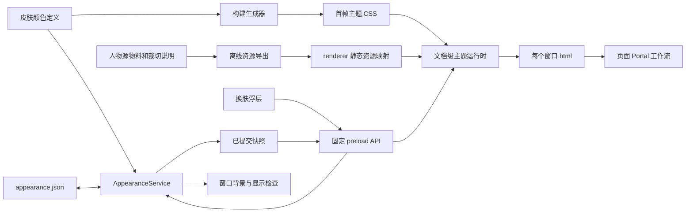

# Hemi 人物主题与换肤技术方案

| 项目 | 内容 |
| --- | --- |
| 版本与日期 | 1.2，2026-10-21（Asia/Shanghai） |
| 状态 | 已接入真实应用；平台验证见实施记录 |
| 产品依据 | [人物主题与换肤需求](../requirements/appearance-and-skins.md) |
| 物料依据 | [人物物料包 v1](../design/appearance-skins/v1/README.md) |
| 源码审查基线 | `559397ac57bdd85893be3380e55e03f2d1501fa3` 加本轮未提交工作树 |
| 运行约束 | macOS、Node.js 22.19+ 的 Node 22 线；项目锁定 Electron 44、React 19、Vite 8 |

采用主进程统一管理外观、语义 CSS 变量驱动页面的方案。六款皮肤共用组件与布局；人物属于皮肤资源，侧栏背景不参与排版。首版仅浅色，不增加人物背景开关，不调整模型、语音或任务配置。

本文给出已落地的模块、接口、启动顺序、并发与错误处理。完整演出、资源生命周期和实测结果见[实施方案与验证记录](appearance-implementation.md)。

冷启动演出和整体场景已按用户澄清扩展，见[冷启动与背景技术补充](appearance-startup-and-background.md)。该补充增加启动舞台、真实 UI 交接和场景资源；下文普通主题提交与多窗口规则继续适用。

## 1 架构选择与现有约束

| 已有实现 | 本方案处理 |
| --- | --- |
| [tokens.css](../../src/renderer/src/tokens.css) 有统一尺寸/字体和单套浅色；`--g-*` 被品牌与状态混用 | 几何 token 保留，颜色按用途迁移；先经典等价，再加入人物皮肤 |
| [ui.ipc.mjs](../../src/main/ipc/ui.ipc.mjs) 从通用配置读写 UI 偏好 | 外观单独存储，不把皮肤写入包含凭据和模型的通用配置 |
| [config-store.mjs](../../src/main/lib/config-store.mjs) 当前通用保存最终使用直接 `writeFile` | 不把它误当成已具备原子外观存储；新增异步原子写入模块 |
| [preload](../../src/preload/index.cjs) 为 sandbox CJS，固定字符串暴露桥接接口 | 不在 preload 中 require ESM 注册表、读磁盘或暴露通用 IPC |
| [main-window.mjs](../../src/main/windows/main-window.mjs) 固定背景，`ready-to-show` 自动 show | 窗口创建前初始化外观；增加主题首帧检查，与现有显示条件共同决定 show |
| [floating-surface.mjs](../../src/main/windows/floating-surface.mjs) 三类透明窗口分别懒创建和 showInactive | 每条创建及显示路径接入同一检查，不只改主窗口 |
| [loader.mjs](../../src/main/windows/loader.mjs) 分 Vite URL 与打包 `loadFile` | 启动主题脚本在两种加载方式下都走相同相对路径 |
| [workflow-flowgram-surface.tsx](../../src/renderer/src/windows/voice/workflow-flowgram-surface.tsx) 创建独立 React root | 颜色由 html 变量继承，必要 JS 参数显式传递；不通过重建编辑器换肤 |
| [InfoPopover](../../src/renderer/src/components/info-popover.tsx) 内部固定上方定位与默认焦点 | 添加可选定位/焦点参数并保留旧默认值；换肤使用右侧定位及当前项初始焦点 |



不采用每款皮肤一套页面、全局 CSS 滤镜或 renderer 自行持久化。CSS 负责颜色传播，React 仅订阅选中项、资源和少量需要 JS 的主题参数，避免换色时整页重挂。

## 2 模块与文件拆分

以下模块已接入生产；设计预览继续作为视觉依据，不代替实际应用。

| 模块或路径 | 职责 |
| --- | --- |
| `src/shared/appearance/skins.mjs` | 六款注册表、完整语义色、原生背景、顺序、支持模式；纯数据，不依赖 Electron/DOM |
| `src/shared/appearance/schema.mjs` | 参数和偏好校验、默认值、快照比较；便于 Node 测试 |
| `src/main/services/appearance-service.mjs` | 权威内存状态、串行提交、去重、revision、广播与恢复告警 |
| `src/main/services/appearance-instance.mjs` | 构建实际实例并注入 userData 路径、IO、日志和窗口适配器 |
| `src/main/lib/appearance-store.mjs` | 有界读取、异常文件保护、原子写入；不复用模型配置存储 |
| `src/main/ipc/appearance.ipc.mjs` | 固定通道、调用者校验；bootstrap 只返回已初始化内存值 |
| `src/main/windows/appearance-window.mjs` | 登记自有窗口、更新原生背景、首帧及恢复显示检查、应用回执 |
| `src/renderer/public/appearance-bootstrap.js` | 无依赖经典脚本，React 与主模块执行前读取桥接快照并设置 html |
| `src/renderer/public/appearance-colors.css` | 构建生成的六款颜色与初始背景规则，不手改 |
| `src/renderer/src/appearance/runtime.ts` | 一个文档一个运行时，版本合并、原子应用、订阅清理、资源竞态 |
| `src/renderer/src/appearance/use-appearance.ts` | `useSyncExternalStore` 适配，返回稳定不可变快照 |
| `src/renderer/src/appearance/assets.ts` | 静态 import 资源 URL 和裁切参数；不拼接 userData 或桌面路径 |
| `src/renderer/src/components/skin-picker.tsx` | 两列六卡、当前态、保存中/错误、键盘与关闭行为 |
| `src/renderer/src/components/skin-watermark.tsx` | 侧栏底层装饰；无事件、无焦点、无排版占位 |
| `scripts/generate-appearance.mjs` | 注册表完整性校验，生成首帧 CSS，提供 `--check` 防漂移 |
| `src/renderer/src/appearance/startup-stage.tsx` | 真实 UI 启动舞台、媒体对齐、中断、双就绪和焦点交接 |
| `src/renderer/src/appearance/theme-backdrop.tsx` | 当前人物媒体、题字、局部动画播放和静态回退 |
| `src/renderer/src/appearance/scene.ts` | 投影真实页面、输入/通话与应用准备状态，不持有业务实例 |
| `scripts/build-skin-assets.mjs` | 离线生成运行所需尺寸并记录 hash；不在用户换肤时执行 |

同步修改现有 `src/shared/ipc-channels.mjs`、`src/shared/protocol.ts`、`src/preload/index.cjs`、`src/main/ipc/index.mjs`、主进程启动、四类窗口、renderer HTML/入口、NavRail、Sidebar、欢迎槽位、样式及 fixture。真实路径与 fixture 共用组件；生产状态来自固定桥接，不使用 fixture 的本地选择逻辑。

## 3 数据契约

### 3.1 持久化偏好

```ts
type SkinId = 'classic' | 'cafe-blue' | 'cafe-purple'
  | 'cafe-orange' | 'cafe-gold' | 'cafe-red';

type AppearancePreference = {
  schemaVersion: 1;
  skinId: SkinId;
  mode: 'light';
};
```

路径为 `path.join(app.getPath('userData'), 'appearance.json')`。不存资源绝对路径、CSS 文本、模型字段、人物开关、sessionId 或进程内 revision。缺文件默认为经典；新装与升级使用同一规则。

### 3.2 运行快照和请求

```ts
type AppearanceSnapshot = {
  sessionId: string; // 每次主进程启动生成一次
  revision: number; // 本 session 内递增，启动时为 0
  preference: AppearancePreference;
  resolvedMode: 'light';
  recovery: null | {
    code: 'INVALID_CONFIG' | 'UNSUPPORTED_CONFIG' | 'READ_FAILED';
    requiresBackup: boolean;
  };
};

type AppearanceSetRequest = {
  requestId: string;
  skinId: SkinId;
  mode: 'light';
};

type AppearanceBootstrap = {
  snapshot: AppearanceSnapshot;
  windowMode: 'main' | 'orb' | 'caption' | 'task-popover';
  backgroundColor: string; // 来自注册表；悬浮窗口固定透明
  coldStart: boolean;
  activity: { visible: boolean; focused: boolean };
};

type AppearanceSetResult =
  | { ok: true; requestId: string; changed: boolean; snapshot: AppearanceSnapshot }
  | { ok: false; requestId: string; code: 'INVALID_INPUT' | 'FORBIDDEN'
      | 'SAVE_FAILED' | 'BACKUP_FAILED' | 'REQUEST_CONFLICT';
      snapshot: AppearanceSnapshot };
```

`sessionId` 避免主进程重启后旧 revision 比较失效，沿用仓库平台快照的思路。同 session 只接受更大 revision；相等可去重。跨 session 时丢弃旧缓存和未完成请求，以新 bootstrap/get 为准，不能简单比较两个数字。

请求只接受白名单字段和值，限制 requestId 长度与 payload 大小，不接受任意对象补丁或图片路径。日志记录错误码、requestId、skinId 和版本，不记录原始异常配置内容。

## 4 IPC 与 preload

| 通道 | 方式与权限 | 内容 |
| --- | --- | --- |
| `appearance:get` | invoke；登记的 Hemi 顶层窗口可读 | 当前快照，无磁盘重读 |
| `appearance:set` | invoke；有换肤入口的主窗口可写 | 校验并提交完整 skinId/mode，返回明确回执 |
| `appearance:changed` | 主进程发送 | 成功提交后的全量快照，包含提交发起窗口 |
| `appearance:bootstrap` | preload 内部的一次 sendSync | 每次文档加载取最新内存快照及窗口 mode；不开放给页面任意调用 |
| `appearance:visual-ready` | renderer 固定桥发送 | 当前版本舞台可绘制；与真实 APP_READY 分开 |
| `appearance:activity` | 主进程发送 | 登记窗口的 visible/focused，用于停止隐藏解码 |
| `appearance:applied` | renderer 经固定桥发送 | `{sessionId, revision, status: 'ready' / 'degraded' / 'error'}`，用于显示检查与测量 |

可信调用者须同时满足：已登记的自有 window/webContents、顶层 frame、预期本地 URL 或明确允许的 Vite 地址。不要只用 `BrowserWindow.getAllWindows()` 广播或仅凭窗口存在就授权；外部登录 `WebContentsView`、子 frame 和弹出的非 Hemi 窗口均不进入外观登记表。

preload 暴露 `getAppearanceBootstrap()`、`getAppearance()`、`setAppearance()`、`onAppearanceChanged()`、`reportAppearanceApplied()`、`reportAppearanceVisualReady()`、`onAppearanceActivity()`。回调只收到净化后的数据，取消订阅仅删除自己的 listener，不使用 removeAllListeners，不暴露 Electron event 或通用 send/invoke。原有 sandbox/contextIsolation 保持。该桥接方式符合 [Electron 44 Context Isolation](https://github.com/electron/electron/blob/v44.0.0/docs/tutorial/context-isolation.md) 的固定接口建议。

bootstrap 同步调用仅用于首帧：处理器在建窗口前注册，直接复制内存值，禁止 await、磁盘 IO、等待 renderer、截图或大资源处理。Electron 明确指出 sendSync 会阻塞 renderer，因此日常读取和写入全部使用 invoke；bootstrap 只执行快照复制与资格计数，不等待 renderer；真实首帧与恢复显示由 Electron 回归验证。[Electron 44 ipcRenderer](https://github.com/electron/electron/blob/v44.0.0/docs/api/ipc-renderer.md)

不把创建时的 `additionalArguments` 或 localStorage 当成唯一启动来源：创建后换过皮肤，再 reload 时它们可能已过期。若实施时能提供同等正确且已验证的异步首帧方案，可替换这一个内部同步通道，但必须保留加载前遮挡与显示检查。

## 5 存储、提交与恢复

### 5.1 初始化

1. 主进程 ready 后、创建任何自有窗口前，执行 `appearanceService.initialize()`。
2. 异步读取有界 JSON，正常配置接受 schemaVersion=1、已交付 skinId、mode=light。缺文件与读失败分别处理。
3. 损坏、未知 ID/模式/版本或过大文件回退经典，并设置 recovery。原文件保留，启动时不自行重写。
4. 生成 sessionId/revision=0，提供纯内存快照，再开放 IPC 和窗口加载。初始化 promise 共享，避免多个窗口重复读盘。

### 5.2 原子提交

为服务维护一个可从失败中继续的 promise 队列，逐项执行：

```text
校验调用者和请求
→ 入队后重新检查当前提交状态
→ 必要时保存异常原文件副本
→ 同目录唯一临时文件写入并 flush/close
→ rename 原子替换目标文件
→ 更新内存 preference/revision，清除 recovery
→ 更新主窗口原生背景并向登记窗口广播
→ 返回同一已提交快照
```

使用异步 fs，临时文件独占创建、权限 0600，名称包含进程与随机部分。失败时清理本次临时文件，保留旧目标。Windows 下 rename 若遇短暂占用可做有限的非阻塞重试；不采用先 unlink 旧文件再写入的降级方式。

rename 成功是提交点。之后目录 flush 若平台不支持或失败，只记录持久化风险，不把已替换文件误报为“未提交”并回退内存。广播失败也不回滚已经保存的偏好，由窗口恢复机制重放最新快照。

同一个发送窗口的 requestId 可在有界缓存内去重；同 ID 配不同 payload 返回冲突。队列结束后无待处理请求且配置健康时，选择当前皮肤是 no-op。若存在排队切换，必须在出队时重新比较：例如当前蓝、已排队紫、随后又选蓝，不能在入口提前丢弃最后一次蓝色请求。

### 5.3 异常配置保护

首次主动保存前，为异常原文件制作唯一、不覆盖的副本，并确认复制成功；失败返回 BACKUP_FAILED，不删除原文件。随后才按当前 schema 写入。回退状态下再次选经典可触发这次明确修复；这与健康配置下重复选择 no-op 区分。

读失败时，若无法确认和保护已有文件，不静默覆盖。未知未来 schema 同样只在用户明确选择且原文件已保留后重建。首版不监听用户手工修改文件，也不把外观文件当作多进程共享数据库；继续依赖应用现有单实例约束。

## 6 首帧加载和窗口显示

### 6.1 初次文档加载

1. `initialize()` 完成后，创建 BrowserWindow，主窗口背景取注册表值；三类悬浮窗口继续 `#00000000`。
2. 在 loadURL/loadFile 前登记窗口及 mode，准备内存 bootstrap；保持当前 show=false。
3. preload 先安装 changed listener 和缓存，再同步取最新 bootstrap，通过 contextBridge 暴露 getter。后续事件先更新缓存，再通知页面订阅者。
4. HTML head 中先加载无依赖的外部经典脚本 `appearance-bootstrap.js`，再加载生成的主题 CSS，最后是现有主模块。脚本设置 data-skin、data-color-mode、data-window、背景和 theme-color，并衔接 preload 缓存。
5. CSS/运行时初次应用完成后，renderer 报告当前 session/revision。带演出的主窗在 ready-to-show 与 BOOT_VISUAL_READY 后可显示同主题启动舞台，APP_READY 另行控制真实界面交接；无演出时等待最新主题回执。其他窗口首次 showInactive 保留最新主题检查，详见启动补充状态机。
6. 回执若过期，发送最新快照并等待对应版本，不显示旧主题。主题加载错误应显示同背景下可重试的错误态并记录原因，不能无期限静默等待或用错误皮肤蒙混通过。

首帧主题脚本不依赖 React、主包、远程网络或任意内联脚本权限。主题 CSS 与几何 CSS 的选择器和加载顺序须经过构建验证，不能在主包导入 tokens.css 后被覆盖。HTML reload 时也重新获取最新内存状态；应用内容在主题就绪前不绘制，背景保持当前主题。

### 6.2 后续切换与隐藏恢复

服务保存后立即广播，不等待所有窗口回执才处理下一次选择。单个窗口关闭、加载中或失败不得拖死全局提交队列。

各窗口独立合并最新版本；主题运行时以一次 DOM 批量更新应用属性和资源，保持 React key、编辑器实例及 Portal 宿主不变。恢复和显示前检查最新版本；隐藏窗口不为人物背景持续解码或重绘，恢复时补齐。已显示窗口若收到更新失败，记录并重试最新快照，不能回滚已提交配置。

Hemi 文档设 `color-scheme: light`；不为首版人物皮肤全局强制 nativeTheme，从而保持外部网页与系统原生对话框的既有模式边界。

## 7 Renderer 与交互实现

### 7.1 文档级运行时

每个文档只建立一个 runtime；在 React 渲染前完成初始应用。`useSyncExternalStore` 仅提供订阅，不承载磁盘或 IPC 副作用。HMR、StrictMode 重挂和页面卸载均清理监听，保证一次 changed 对应一次应用。

内部区分 committedSnapshot、appliedSnapshot、pendingRequest 和 focusedSkinId。勾选与“使用中”对应主进程成功快照；pending 不伪装成功。方向键从当前焦点项继续移动，不能因为保存未结束而反复基于旧选中项计算。

新资源 prepare/decode 带应用代次；旧异步解码完成后检查版本，禁止紫色已提交后迟到的蓝色解码把头像换回去。失败使用 Hemi 标记/无背景降级并上报，不阻断会话。资源准备可以与保存等待并行，但保存失败不改变已应用皮肤。

### 7.2 浮层

复用 InfoPopover/Base UI 的生命周期、碰撞、窄窗遮罩与焦点规则。为现有组件增加可选 side、align、initialFocus 参数，旧调用保留默认行为；不能全局修改定位使其他浮层跟着迁移。

换肤在桌面采用入口右侧、底部优先对齐，碰撞时夹到可用视口；≤600px 继续底部面板。外层 392px，内部六张 100px 高卡片、2 列、10px gap；沿用当前字体/6px 卡片圆角，错误反馈只在异常时临时出现。

单选组使用 roving tabindex，左右 ±1、上下 ±2、首尾循环；点击与方向键调用同一提交方法。关闭不撤销；Esc 在浮层内优先消费，避免同时触发应用停止/拒绝快捷键。点外关闭尊重点击目标，键盘关闭返回入口。

### 7.3 侧栏背景

仅在侧栏容器增加绝对定位装饰层，建立明确局部层级：水印 0，原会话控件 1。`pointer-events:none`、`user-select:none`、`aria-hidden=true`，不添加 spacer，不进入滚动内容高度。现有 sticky 标题与滚动容器不改定位规则。

人物 width/right/bottom/opacity/mask 由皮肤资源定义提供；普通文字不透明。hover、selected、重命名输入使用足够实的表面，不用透明叠加导致叠字。经典没有水印节点或资源请求。抽屉模式使用同一组件，不能只覆盖宽屏侧栏。

### 7.4 工作流与其他页面

Flowgram 独立 root 继承 html 的 CSS 变量，必要的 JS theme 参数显式传入；不要改变组件 key 或重建 DI/编辑器实例。第三方 CSS 在首次懒加载后仍须服从语义映射，覆盖节点、线、端口、选区、点阵和 inspector。

主页面只替换颜色与资源，保留输入、附件、引用、滚动、预览、未保存工作流和运行状态。模型、录音和任务服务不订阅皮肤变化。图片、视频、外站与导出文件的内容保持原样。

## 8 颜色与资源构建

### 8.1 颜色来源

完整颜色注册表是唯一来源；生成器输出首帧 CSS 和必要的类型/元数据，Node 窗口适配器直接读同一注册表。`tokens.css` 保留几何，历史色阶在过渡期映射到明确用途。

迁移优先级：外壳/浮层 → 共用控件 → 对话/输入 → 设置/技能 → 工作流 → 悬浮面。每一步先比较经典与原有计算样式，再检查五款颜色。不要简单把全部 `--g-*` 替换成主题强调色；运行与成功必须独立。

`generate-appearance --check` 检查六款顺序、语义键完整、合法颜色、窗口背景与 CSS 一致、无额外几何字段，并比较生成文件是否过期。将该检查接入 dev/build，而非每次运行时生成。

### 8.2 图片分层与打包

[物料 manifest](../design/appearance-skins/v1/manifest.json) 为设计源物料清单，包含原图 hash、尺寸、透明信息、裁切和背景参数；它不是生产运行时 manifest。完整母版保留在 docs/design，不随应用全量装入内存。

当前导出 960px 宽静态人物、256px 方形头像/卡片共用裁切，以及约 1000px 宽的透明动画。侧栏与主页复用静态人物，避免再打包重复的侧栏副本；卡片和欢迎头像复用相同人脸来源。离线浏览器 Canvas 处理 WebP，FFmpeg 编码 VP9 alpha；用户换肤路径不执行图片加工，也不新增 renderer 依赖。

导出文件放入 `src/renderer/src/assets/skins/`，由静态 import 映射给 renderer，让 Vite 管理开发/构建资源 URL。不要把运行时字符串路径传给 `new URL` 期待 Vite 自动分析；不要引用桌面或 docs 路径。[Vite 静态资源](https://vite.dev/guide/assets.html)

无依赖 bootstrap 脚本和生成颜色 CSS 使用 public 的稳定文件名，并在最终 HTML 中输出适合 `base:'./'` 的相对引用；同时验证 HTTP 开发页与 file 协议打包页，不能直接把 `/appearance-bootstrap.js` 留在打包 HTML 中。

资源预算为工程目标：全部卡片与头像压缩后合计 ≤600KiB，五张侧栏图合计 ≤3MiB；超出时先调整尺寸/编码并复核边缘，不能用降低正文可读性代替。当前已通过本地浏览器 Canvas 导出 WebP，透明影片由 FFmpeg 编码 VP9 alpha；不新增 renderer 依赖。

## 9 故障与观测

| 故障 | 处理与观测 |
| --- | --- |
| IPC 调用者或参数非法 | 固定错误码，无磁盘写入和广播 |
| 写盘/rename 失败 | 配置与内存均保留上次成功；UI 提示，队列仍可处理下一项 |
| 异常配置备份失败 | 不覆盖原文件，BACKUP_FAILED |
| 旧回执/旧事件/旧图片 decode | 按 session/revision/requestId/应用代次丢弃 |
| 窗口关闭或 renderer 崩溃 | 移除登记与监听，重建/重载时取当前状态 |
| 加载 CSS 或 bootstrap 失败 | 首帧检查不通过；记录加载 URL/错误码并给出明确重试，不展示错色页面 |
| 资源缺失 | 配色照常，头像回退、背景空缺；记录资源 ID，不记录用户内容 |
| 平台原生窗口差异 | 分平台验证透明和标题栏，不由 CSS 截图推断 |

生产日志记录有界错误码，不写用户内容。回归脚本在真实主进程中临时采集提交与 applied 的耗时和版本，不给正式 renderer 增加诊断权限。P95 用主进程同一时钟测提交至 applied 回执，renderer 回执须在已应用颜色和本次可见资源绘制后的帧发送；该数值含 IPC 返回延迟，是保守的应用耗时。点击至提交单列，首次显示单列，隐藏窗口不混入可见窗口 P95。真实卡片的 pointerdown 至已提交快照广播另行采样，包含写盘与 IPC。

不为遥测保留人物解码对象或不断增长的请求记录；请求缓存、诊断和资源缓存都设上限。日志沿用现有 logger，禁止附带凭据、个人对话或录音。

## 10 测试与任务拆分

| 工作包 | 主要验证 | 对应需求验收 |
| --- | --- | --- |
| T-01 注册表/生成器/资源 | 六款完整性、生成漂移、hash/alpha/尺寸、路径打包 | AC-02、05、14、16 |
| T-02 存储和服务 | ENOENT/损坏/未来版本/读失败、备份、原子提交失败、队列恢复、快速蓝→紫→蓝、no-op | AC-08、09 |
| T-03 IPC/preload | 真实白名单、bootstrap、订阅取消、无事件泄漏、回执乱序 | AC-03、09、10 |
| T-04 四类窗口启动 | Vite/构建冷启、reload、首次懒建、隐藏恢复、过期 ready 回执、透明底 | AC-10、15、17 |
| T-05 入口/浮层/背景 | 六卡/无开关、键盘焦点、点外、错误、50 条会话全部列表操作 | AC-01 至 07 |
| T-06 全页迁移 | Portal 已开、两种工作流加载顺序、状态/草稿/通话/任务/授权保留 | AC-11 至 14 |
| T-07 性能与平台 | 至少 30 次切换 P95、监听/内存趋势、资源失败、Windows/macOS 实机 | AC-15 至 17 |
| T-08 影片与场景 | 首尾帧、人物动作、前景遮挡、UI 开口、常驻背景和宽窄窗构图 | AC-18、20、22 |
| T-09 启动交接 | 双就绪信号、实际 DOM 展开、跳过、错误回退、资源释放与跨平台播放 | AC-18 至 22 |

逻辑模块用 Node 测试注入 IO/时钟，但真实 IPC 和 Electron 窗口另做集成验证，不能只以 mock 通过为完成。首帧需要录制/捕获实际可见帧，单张最终截图不足以排除闪色。

实施完成按届时 AGENTS.md 执行 npm test、npm run build、spacing 和受影响原生检查；依赖变化按要求生成 notices。使用全新 HEMI_USER_DATA_DIR 隔离，分别记录 Vite 与构建 renderer 的 commit、工作树、机器、命令、证据及未通过项。

建议顺序为 T-01 → T-02/03 → T-04 → T-05 蓝色打样 → T-06 六款全局 → T-07。每一步先保持经典等价，出现回归可回到经典，不删除用户已保存的选择或其他业务配置。

## 11 本轮交付和剩余验证

本轮交付六款皮肤、原子存储和固定 IPC、四类窗口同步、六卡入口、侧栏水印、主页人物/题字、完整冷启动和局部动画，以及源物料到打包资源的导出脚本。

准确验证环境、命令、结果、性能与剩余项统一见[实施记录](appearance-implementation.md)。Windows 实机和真实模型/语音执行中的长期观察仍单列，不以当前平台的 UI 回归替代。
