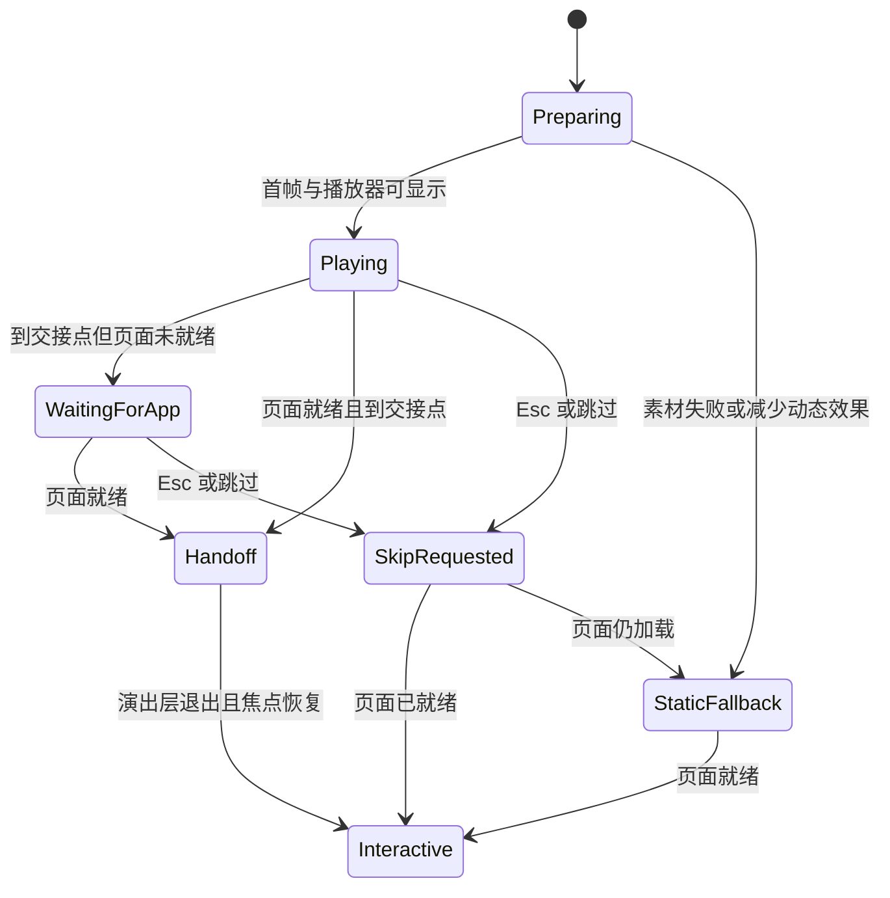

# Hemi 冷启动演出与主题背景扩展方案

日期：2026-10-21。状态：用户已确认冷启动和主页常驻动画两种都需要；已有界面动效预演，完整人物素材与真实应用接入待完成。

关联：[产品需求](../requirements/appearance-and-skins.md)、[主题技术方案](appearance-and-skins.md)、[已有源物料](../design/appearance-skins/v1/README.md)。本补充将冷启动演出和全局背景纳入皮肤；替代此前“只做静态侧栏人物、视频后置”的限制。已确认的换肤入口、两列卡片和无人物背景开关继续沿用。

## 1 目标与可行性

每套人物皮肤同时包含配色、人物、常驻背景图和启动演出。启动时展示人物动作与场景，真实 Hemi 页面随演出展开，交接后可以直接操作，场景背景留在主题中。目标覆盖视频中的人物演出、镜头运动、特效、界面展开和连续交接；不能仅用 PNG 淡入代替全部演出。

参考 [Dragon Codex Boot](https://github.com/yushua0808-cpu/dragon-codex-boot) 将启动视频衔接到真实窗口，Windows 使用 DWM 实时缩略图，macOS 采用覆盖层淡出。Hemi 可控制自身 renderer，因而可在窗口内组织真实 DOM 和演出分层，无需把外部应用嵌入视频。该路线是基于现有架构的可行性判断，尚未完成动态样机或跨平台实测。

[main-window.mjs](../../src/main/windows/main-window.mjs) 已有 show=false 与 ready-to-show，[main.tsx](../../src/renderer/src/main.tsx) 控制主界面渲染；需要新增启动舞台与就绪协调，不能把播放视频直接塞到当前自动 show 之后就视为衔接完成。

## 2 创意与物料

先以晴海蓝制作一支建议约 6 秒的样片，验证完整流程，再为其余角色设计各自动作。下表为首支创意提案，具体节奏由样片确定，不要求五款只换颜色复用同一段演出。

| 时间提案 | 画面与动作 | 工程配合 |
| --- | --- | --- |
| 0–1.2 秒 | 冷白与蓝色场景出现，人物进入或转身看向用户 | 启动舞台先显示同主题首帧，后台加载真实页面 |
| 1.2–3.6 秒 | 人物抬手/引导，水纹或光带带出界面平面 | 背景视频与人物前景分层，UI 平面开始显现 |
| 3.6–5.2 秒 | 界面平面展开、靠近，逐步成为正常 Hemi 窗口内容 | 在平面内显示已加载的真实页面，按关键帧变换 |
| 5.2–6 秒 | 特效退场，人物退出前景，主题背景留下 | 移除演出层、恢复 UI 变换，交还输入与焦点 |

现有 5 张透明母版和 5 张头像裁切可以用于身份参考、静态海报与工程样机。完整动作仍需制作新的视频/动画素材，不能把现有 PNG 当成已完成的人物表演。

| 新资源 | 用途与要求 |
| --- | --- |
| 常驻场景背景 | 每款提供横版构图与可裁切区域；人物/装饰避开阅读和输入的主要位置，兼容 560px 窄窗 |
| 启动首帧 poster | 播放器准备、失败和减少动态效果时都能立即显示；与首个视频画面一致 |
| 场景底层 | 不烘焙真实软件文字；可用视频或静态场景加程序特效 |
| 动态人物前景 | 完整人物动作与表情；按需要提供透明前景或人物/遮挡 mask，保留头发与手部边缘 |
| 交接关键帧 | 时间、UI 平面四角/变换、裁切区域、前景遮挡关系、结束背景；使用归一化坐标 |
| 静态结束帧 | 无明显跳变地接入常驻背景；不保留假的软件窗口和不可点击按钮 |

完整人物动作可通过视频生成或动画制作完成，场景和真实 UI 的合成由应用控制。按 hypit 制作流程，先定分镜、身份参考和首尾帧，再制作动作、分层和试片；最终应检查连续播放，而非只验收几张截图。源码项目中的演示 MP4 不直接替代我们这组人物的新素材。

当前环境有 hypit 技能说明，但本轮未发现 PATH 中可直接使用的 hypit 命令，也未验证视频生成账户、端点或额度。本轮不安装生产工具、不连接账户、不提交付费生成；工程样机与分镜可先行，完整生成另需可用服务或制作完成的视频。安装技能本身不代表已有模型调用能力。

## 3 应用内分层与真实页面交接

```text
BootStage
├─ SceneLayer            场景视频/背景与光效
├─ AppSurface            同一份真实 Hemi 页面，按关键帧缩放/透视展开
│  ├─ ReactRoot          当前应用实例，交接时不重建
│  └─ StablePortalHost   需要随平面呈现的弹层，创建后不迁移
├─ ForegroundLayer       动态人物、前景遮挡和特效
└─ SkipControl           跳过，始终可达

交接后：AppSurface 变换归零，演出层卸载，ThemeBackdrop 保留。
```

同一个 BrowserWindow 内完成第一版，保留用户窗口位置、尺寸和系统按钮。真实 AppSurface 直接参与合成，不把最终界面烘焙在视频里，也不通过录屏权限抓取用户会话。交接前禁用其指针/键盘命中，交接后恢复原有焦点和可操作状态。

矩形界面展开可用 CSS transform/clip-path；需要更明显透视时，以归一化四角求平面投影。先用样机核对视觉和文本清晰度。若镜头要求弯曲、卷曲或复杂非平面变形，再评估纹理合成/网格方案，不承诺单个 CSS 平面能实现任意形变。

前景人物若要跨过 UI 边界，必须提供透明层或遮挡信息；一段只有合成后矩形画面的 MP4 不能自动分离人物和真实 UI。透明视频的编码、GPU 解码与边缘需在锁定 Electron 44 和目标平台实测；不支持时可使用经过预算验证的图像序列或其他分层载体。

现有 Portal 默认可能挂在 body。需要参与启动变换的自有 Portal 从创建开始就选同一稳定宿主，不能在交接时搬节点；恢复中的授权/对话框也须正确呈现。交接不重建页面、工作流或业务服务。

## 4 启动状态与故障



需要分别维护 BOOT_VISUAL_READY 与 APP_READY：前者使同主题启动舞台可显示，后者表示真实页面与主题可以交接。不能继续让主窗口一直隐藏到完整演出结束，也不能为了播放动画阻止页面后台加载。

- 冷启动时按已保存皮肤播放；恢复已有窗口、打开悬浮窗口和普通换肤不反复播放完整片头。经典保留简短品牌过渡。
- Esc 和可见“跳过”按钮结束演出；页面已就绪则立即交接，未就绪则转静态加载态，不伪装已可操作。默认静音。
- 人物演出只播放一次，结束释放该段解码与前景资源；主页常驻使用独立轻动效素材，会话阅读时保持静态，不反复播放片头。
- 片头加载/解码失败、窗口缩放、切屏或减少动态效果时，使用同皮肤 poster/静态背景完成可恢复交接。
- 到交接点而应用未就绪，可停在预留静止节点；过长等待须显示真实加载/错误与重试，不能无限锁住启动。
- 播放期间若收到更新的外观快照，取消旧演出并应用最新静态皮肤；不让迟到回调恢复旧皮肤，也不立即重播另一段长片头。
- 声音、可用加载时长、超时策略与运行耗时分别度量；动画时长不应被计成 200ms 普通换肤应用预算。

## 5 常驻背景与皮肤契约

常驻背景可覆盖主窗口整体，包括外壳、侧栏和欢迎场景。正文、输入、代码、设置表单等使用满足对比度的内容表面，不把“人物只准出现在侧栏”作为本轮限制。背景不参与排版、不拦截操作、不随会话列表滚动；满列表规则继续成立。

主页视觉已补充[右侧人物、左侧少量主题文字的打样](../design/appearance-skins/home-background-v1/README.md)。场景与人物沿用启动样片的视觉来源；主页人物清晰，阅读态提高内容表面遮盖度并收起装饰文字。沿用当前 renderer 的空态判断：`data-empty='true'` 表示主页，非空态不设置该属性；不要按不存在的 `data-empty='false'` 匹配。正式实现应从同一业务状态派生显示，背景组件不创建新业务状态或设置项。

每款资源定义扩展为 palette、portrait、sidebarWatermark、sceneBackground、startupPoster、startupScene/foreground、handoffKeyframes。skinId 同时选择整套配色和资源；继续不增加人物背景开关，不把视频路径或外部脚本写入用户偏好。

视频与场景资源随应用本地发布，由构建清单提供 URL、hash、尺寸和支持编码。普通窗口切换只需加载对应静态背景，不预解码全部角色片头；只有冷启动所用片头进入播放资源。新旧解码回调同样按皮肤版本/播放代次丢弃。

### 5.1 主页常驻动画

新增 idleScene/idleCharacter、blinkClip（可选）和 staticRestPose 资源；启动完成姿态、常驻起始姿态与静态回退相互匹配。人物分层至少考虑眼睛、头部、发丝、躯干与衣饰，完整表情和关节动作由新素材提供。当前 PNG 只能完成整图运镜与浮动。

统一状态建议为 Intro → HomeIdle → StaticReading / StaticInput / Suspended；进入非空会话、输入聚焦/输入中、窗口失焦/隐藏及减少动态效果时停止常驻绘制与解码调度，保留可立即显示的静态姿态。恢复只继续主页轻动效，不重播片头；素材或解码失败回退静态背景。所有状态从已有窗口、输入和会话状态派生，不新增背景开关。

常驻只调度选中皮肤的资源；各层共用时钟并按播放代次取消旧回调。阅读/隐藏状态无无意义 rAF 循环、定时绘制或持续视频解码。交接前后先记录静态基线，再测当前设备的 CPU/GPU、内存与解码峰值，性能预算以实际素材和目标 Electron 平台验证。

[预演 v2](../design/appearance-skins/motion-preview-v2/README.md) 使用从当前 fixture 导出的 inert DOM/CSS 快照实现冷启动界面展开与主页整图轻浮动，并支持只读阅读态切换。其交接与时钟检查只证明该预演的行为，不代表真实 React 实例、焦点、输入状态或启动就绪已经接入。

### 5.2 人物素材制作路线建议

针对当前晴海蓝 PNG，建议制作端采用 Live2D 拆层、补画与绑定，先交付同画布、同锚点的冷启动前景和主页循环透明视频；Hemi 首版以本地视频层合成真实界面。现图闭着的眼睛、被头发遮住的脸，以及抬手后露出的手臂区域须补画。完整拆层、动作和交付清单见[人物动画制作建议](../design/appearance-skins/character-animation-production.md)。

Live2D [官方导出说明](https://docs.live2d.com/en/cubism-editor-manual/exporting-images/)支持透明 WebM；Hemi 的实际透明解码与边缘表现仍须跨平台验证。另一种出口是模型、纹理及动作数据，由[官方 Web Framework](https://github.com/Live2D/CubismWebFramework)配合 Core 播放；该方案需单独验证依赖、版本、资源加载和现有 CSP，本轮不直接引入 SDK 或放宽安全策略。

## 6 验证与下一步

1. 先做晴海蓝的首尾帧和分层分镜，明确人物动作、真实 UI 开口及结束背景。
2. 用现有 PNG 与实际 Hemi DOM 做时间、透视、遮挡和交接样机，标明为工程样机，不冒充完整人物视频。
3. 接入一支实际动作短片，检查连续播放、暂停节点、焦点、跳过、加载失败和真实界面可操作性；通过后扩展其余人物。
4. 分别验证 Vite/构建 renderer，以及 macOS/Windows 的解码、透明、窗口缩放、显示缩放和减少动态效果。
5. 记录媒体首帧耗时、解码/内存峰值、APP_READY 时间、片头完成与可操作时间；演出结束后无残留解码、监听、遮挡或输入锁。

本次更新只澄清范围、分镜与实现路线，未生成完整角色视频，也未修改产品启动链路。审查基线为 `13284129bc199d23d33b45bbb5c90af9711e8067`；现有静态物料继续保留，启动演出以实际样片为下一阶段验收对象。
