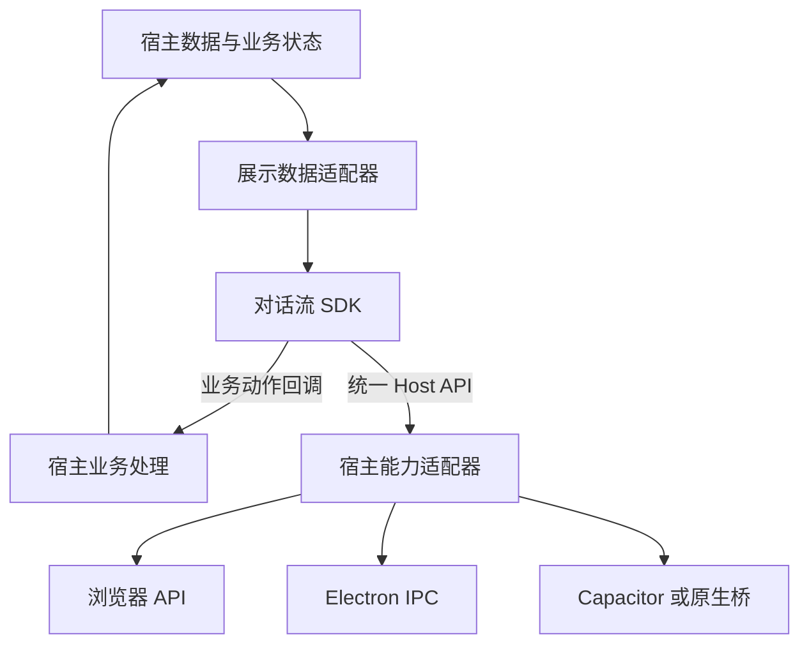

# Hemi 对话流 SDK 抽离技术方案

| 项目 | 内容 |
| --- | --- |
| 版本 | 1.1 |
| 日期 | 2026-10-23，Asia/Shanghai |
| 状态 | 首版已实现；实际接口以 SDK 类型为准 |
| 需求 | [对话流 SDK 抽离需求](../requirements/conversation-flow-sdk.md) |
| 基线 | `4e6f51707269cd4152ed7da9cd4fc00c21ca12c1` 加当前工作树，不能只从 HEAD 复制组件 |

实施结果、目录、验证证据与移动端剩余工作见[实施记录](conversation-flow-sdk-implementation.md)。

采用一个包承载完整前端会话 SDK：`/core` 管理会话状态、草稿、待发送队列、恢复及投影，`/react` 提供生命周期和订阅，原有入口继续提供受控展示。通信、存储、生命周期与系统能力通过宿主接口注入。具体会话核心方案与验收见 [会话核心实施说明](conversation-flow-sdk-session-core.md)。

## 1 依赖方向（受控展示入口）



SDK 的业务数据只有 props 一条输入路径。组件内部不导入会话服务、Agent、模型 SDK、SSH、工作流引擎、应用配置或主进程。`conversation-flow.mjs` 的任务归约、`flow-replica.ts` 的版本追平和 `useConversationFlow` 的订阅继续由宿主管理；它们不因名称包含 flow 就一起搬进展示 SDK。

在 SDK 中访问 DOM、滚动、媒体解码、观察器和计时器属于前端实现。访问操作系统、读取受控文件、查询业务档案、决定权限或执行任务属于宿主。

## 2 现有实现与抽离位置

| 现有实现 | 当前耦合或行为 | 处理 |
| --- | --- | --- |
| [VoiceScreen](../../src/renderer/src/windows/voice/voice-screen.tsx) 内的消息行、阶段简报和回复复制 | 与语音、输入区、侧栏、预览 Tab 和任务快照混在一个页面 | 提取消息行和纯展示合并逻辑；外壳及业务取数留在应用 |
| [TurnParts](../../src/renderer/src/windows/voice/turn-parts.tsx)、[分组函数](../../src/renderer/src/windows/voice/lib/turn-display-blocks.ts) | 分组函数已是纯函数，组件依赖应用路径和卡片 | 连同组件和分组测试迁移，保留 part 和调用的稳定身份 |
| [TurnActivity](../../src/renderer/src/windows/voice/turn-activity.tsx)、[ThinkingBlock](../../src/renderer/src/windows/voice/thinking-block.tsx)、[ToolActivity](../../src/renderer/src/windows/voice/tool-activity.tsx) | 使用应用类型、样式、计时和展开状态 | 改用 SDK 展示类型、作用域样式和共享展示时钟 |
| [CompactDelegation](../../src/renderer/src/windows/voice/compact-delegation.tsx) | 接收完整任务快照，过程打开和停止由回调处理 | 提炼为 TaskView；保留紧凑行、后台标签、终态语义和回调 |
| [RunActivity](../../src/renderer/src/windows/voice/run-activity.tsx) | 使用应用协议和命令说明格式化，当前位于输入区附近 | 提取同形态纯部件；桌面在原队列／输入区附近组合，不因迁移改变位置 |
| [PermissionCard](../../src/renderer/src/windows/voice/task-panel.tsx) | 与任务档案读取同文件，Esc 检测查询全局弹层 | 拆出纯确认卡；只在当前实例和受控弹层内处理键盘，任务档案留宿主 |
| [WorkflowCard](../../src/renderer/src/windows/voice/workflow-card.tsx) | 直接查询 invocation、模型目录；保存草稿并执行操作；发送全局预览事件 | 提供完整 WorkflowView，查询与变更移到宿主，预览改为动作回调 |
| [DeliverableCards](../../src/renderer/src/windows/voice/deliverable-card.tsx) | 直接解析路径、读取文件、查询程序并通过 IPC 打开 | 接 Host resources，保留视口附近读取、去重、图片比例和错误状态 |
| [Markdown](../../src/renderer/src/shared/markdown.tsx) | 全局打开链接；部分图片读取与应用登记文件绑定 | 改为 Host 接口；保留现有 Markdown 解析、链接边界处理和失败占位 |
| [VirtualTranscript](../../packages/conversation-flow/src/components/virtual-transcript.tsx) | 向上查找应用 ScrollArea，依赖 Markdown 缓存与跨行复制 | SDK 自有唯一滚动根；其余算法保留，焦点和选择事件按实例过滤 |
| [TranscriptRowState](../../src/renderer/src/windows/voice/transcript-row-state.tsx)、[TranscriptBoundary](../../src/renderer/src/windows/voice/transcript-boundary.tsx) | 局部状态可复用；错误边界使用应用日志 | 保留按行和 part 的状态；诊断经可选回调交宿主，无隐式遥测 |
| [flow-timeline-view](../../src/renderer/src/windows/voice/lib/flow-timeline-view.ts)、[flow-deliverables](../../src/renderer/src/windows/voice/lib/flow-deliverables.ts) | 将 Hemi 内部 flow、历史档案和任务结构投影为界面 | 保留为 Hemi 数据适配器，输出 SDK 类型；SDK 不理解档案格式 |
| [FilePreviewPanel](../../src/renderer/src/windows/voice/file-preview.tsx)、[DocumentPreview](../../src/renderer/src/windows/voice/document-preview.tsx) | 预览 Tab、主进程查询、PDF／Office 资源与桌面布局 | 保留宿主，收到 preview.open 后沿用现有实现；不带进基础包 |

Hemi 数据适配器还负责旧档兼容、同任务简报、回复复制范围、内联子任务去重，以及旧任务结果的展示规则。只能对内置展示模型做确定性转换，不从正文猜测任务成功或扩大文件登记范围。

## 3 包结构与依赖

建议包名为 `@hemi/conversation-flow`，先在本仓库以独立包构建和安装验证；名称不代表已取得 npm scope 或已公开发布。

```text
packages/conversation-flow/
  src/
    core/             会话、草稿、快照追平、待发送记录、队列与消息投影
    react.ts          React 生命周期与外部状态订阅
    components/       消息、队列、过程、确认卡、工作流卡、资源卡、菜单
    presentation/     分组、复制内容、摘要、展示计时和局部状态
    host/             Host 类型与 Provider
    types/            公开展示数据、动作、结果
    styles/           隔离后的规则、token 默认值、主题
    index.ts          组件与类型导出
  package.json
  LICENSE
  THIRD-PARTY-NOTICES.md

src/renderer/src/windows/voice/
  conversation-flow.tsx               展示数据投影、工作流查询与动作处理
  lib/conversation-flow-host.ts        Electron 能力适配

examples/conversation-flow/
  独立消费示例和合成数据，不引用 Hemi 应用源码
```

以上目录现已实现；组件与适配器按实际文件组织。以一个包承载 UI 与会话核心，不另设 Bot Client 包或 Node 服务包。宿主适配器留在各自应用，SDK 只导出它们必须遵循的类型。

React 和 React DOM 以当前 19 系列为首个 peer 兼容基线，实际范围经安装验证后写入清单。Markdown、GFM、图标、虚拟列表和必要的前端菜单依赖从当前锁定版本起步，按实际打包方式声明依赖和版权。包内只保留实际使用的前端组件，不引入工作流画布、Electron、Node 内置模块或 PDF／Office 解码依赖。

产物提供 ESM、`.d.ts` 和预编译 CSS，明确声明 CSS 的 side effects；React 不重复打包。消费方无须定义 `@/`、`@shared` 或安装 Tailwind／PostCSS。包根导入不读取 `window`、`document`、原生插件或全局配置，类型入口无 React 运行时副作用。SSR 至少保证导入和静态首屏安全；虚拟列表的测量在挂载后启用，避免 hydration 时访问 DOM。

主入口默认组合消息流、授权和运行摘要。另以 `/parts` 子入口导出同一实现的确认卡、运行摘要等纯部件，使用同一 scope、host 和 onAction 契约。桌面把部件放回原来的授权区和输入区附近，同时不再把对应数据传给主入口，避免重复展示。部件导出只服务宿主布局，不复制一份渲染实现。

## 4 公开组件接口

```ts
interface FlowScope {
  environmentId: string;
  conversationId: string;
  generation: string;
}

interface FlowSurfaceState {
  loading?: boolean;
  notice?: string;
  permissionRequests?: readonly PermissionView[];
  runActivity?: RunActivityView;
  scrollIntent?: { id: string; kind: 'follow-latest' };
}

interface ConversationFlowProps {
  schemaVersion?: 1;
  scope: FlowScope;
  messages: readonly MessageView[];
  state?: FlowSurfaceState;
  host?: ConversationFlowHost;
  onAction?: FlowActionHandler;
  active?: boolean;
  appearance?: FlowAppearance;
  onDiagnostic?: (diagnostic: FlowDiagnostic) => void;
}

interface ConversationFlowHandle {
  scrollToBottom(options?: { behavior?: 'instant' | 'smooth' }): void;
  scrollToMessage(
    messageId: string,
    options?: { align?: 'start' | 'center' | 'end' }
  ): Promise<FlowResult<{ found: boolean }>>;
}
```

此处和后续代码为接口设计摘录；引用类型的字段约束在本方案的数据表中定义，实现时统一落到包内 `.d.ts`，以真实消费者编译冻结契约。

`schemaVersion` 缺省为 1，表示 SDK 展示数据契约，不是 Bot 连接协议。`active` 缺省为 true，后台状态由宿主传入。`appearance` 只控制对话流主题和只影响本实例的布局 token，不含模型、角色路由或业务开关。`onDiagnostic` 可省略，省略后不上传或全局记录；FlowDiagnostic 仅含诊断 code、scope、对象 ID 和可展示说明，不回传整份消息或宿主凭据。React ref 使用上述句柄；不存在 append、patch、clear 等另一套消息写入口。

空数组表示没有消息，loading 与 notice 独立。宿主每次显式发送后改变 `scrollIntent.id` 可沿用现有“自己的新消息跳底”；单纯前插历史不会触发此意图。正在阅读历史时，模型增量和任务状态更新不改变 pinned 状态。未加载的 scrollToMessage 返回 `found: false`，不查询历史。smooth 滚动仍受减少动态效果偏好约束。

最小静态接入只需要 scope、messages 和样式；host 与 onAction 可省略。完整宿主接入示意如下，变量均由消费应用创建：

```tsx
import { ConversationFlow } from '@hemi/conversation-flow';
import '@hemi/conversation-flow/styles.css';

<ConversationFlow
  ref={flowRef}
  scope={scope}
  messages={messages}
  state={surfaceState}
  host={hostAdapter}
  onAction={handleAction}
  active={pageActive}
  appearance={appearance}
/>
```

## 5 展示数据契约

### 5.1 基础规则

SDK 接收不可变快照。宿主替换已变化的消息和 part 对象，未变化对象可复用引用；不能原地修改对象后期待组件检测隐式变化。正文增量在外部合并为累计内容，SDK 不消费 SSE、WebSocket、SSH 字节流或模型事件。

scope 由运行环境、会话和展示代次组成。Hemi 的数值 generation 在适配器中转换为稳定字符串；环境由宿主绑定身份产生，不能使用显示名称、目录名或固定的 local 值代表所有机器。组件的行状态、资源缓存、表单、计时和回执都携带 scope。代次切换清理旧 UI 状态，不能将编辑重跑后的旧卡继续视为当前卡。

MessageView 和 Part 的身份由适配器提供。旧档可确定性补齐身份；流式 part 在首次出现时分配后保持，不在 render 中生成 ID。SDK 按数组原序显示，createdAt 仅用于展示。

### 5.2 必须保留的数据

| 类型 | 必须可表达的内容 |
| --- | --- |
| MessageView | id、revision、可选 runId、author 为 user／assistant、createdAt、正文或有序 parts、活动与尾段状态、已停止／错误、可用动作及禁用原因 |
| 用户消息附属内容 | 附件资源引用、文件名与类型、引用标签、技能标签、输入来源、已编辑标记；仅将原来可编辑的消息声明为可编辑 |
| TextPart | 稳定 partId、Markdown 累计内容 |
| ThinkingPart | partId、累计内容、开始／结束时间、中断标记；活动态由数据明确给出 |
| ToolPart | partId、toolCallId、名称、显示参数与说明、running／done／error／stopped 状态；不带执行函数 |
| TaskPart 与 TaskView | taskId、调用关系、角色及标题、说明、后台标记、阶段、终态及原因、起止时间、只读／冻结状态、可停止和可查看过程条件 |
| FilePart 与 ResourceView | 稳定资源引用、内容版本、文件名、类型、大小、说明、执行位置显示标签、可选已提供缩略图 |
| NoticePart | 明确的提示／错误类别、主文案、详情和可重试条件；保留当前错误文案转换规则 |
| PermissionView | permissionId、revision、所属运行／任务、kind、摘要、命令／路径显示值、允许的选项与顺序、剩余有效期／参考时间、只读／过期状态、队列标题 |
| RunActivityView | 当前运行阶段、等待起点、命令说明、原始命令显示值、最近输出与输出时间、命令截断标记、资源及占用摘要 |
| UsageView | 当前已展示的输入、输出、缓存、耗时等统计和对应作用域；不包含访问凭据 |

公开类型使用判别联合及明确字段。tool 显示参数和表单值允许 JSON 值；这不意味着允许把整份服务配置或对象实例透传。未知 part 保留顺序并显示可识别的不支持内容提示，通过诊断通知宿主，不因一个新 part 清空整段消息。

MessageView 的 revision 供编辑冲突校验与展示失效使用，不取代 Bot 网络协议的版本。受控展示入口不自行比较网络快照；会话核心使用 revision／generation 追平、过滤过期响应，再产生 MessageView。

远端时间与本机时间可能不同。宿主将权限剩余时长和计时基准转换为可在本机展示的参考时间，SDK 不自行猜测服务器时钟；倒计时结束只能禁用前端入口，不能产生业务决定。

### 5.3 工作流卡片完整性

WorkflowView 必须足以独立绘制当前 WorkflowCard，而不是仅保留标题与 status。宿主输出以下展示投影：

| 区域 | 数据 |
| --- | --- |
| 标题与过程 | invocationId、workflowRunId、版本、标题、流程摘要、当前节点名、进度计数、等待原因和错误 |
| 准备参数 | 字段 ID、标签、类型、必填、选项、当前值、校验问题、ready、draftRevision；表单按当前交互实现展示，不引入执行图 |
| 模型选择 | 已选模型标识和标签、可选项的标识／标签／可用原因；不传供应商 Key、账号令牌和模型解析服务 |
| 核对与继续 | 需核对的输出字段、确认状态、retry／skip／stop 等当前已支持选项、补充说明 |
| 人工输入 | interactionId、revision、字段及预填、草稿、可提交 actionId、提交后的只读记录 |
| 交付与动作 | 有序输出摘要、文件资源引用、开始／停止／继续／取消准备／编辑参数／预览的可用条件 |

交互草稿属于局部 UI 状态；持久化继续通过 onAction。为保留当前 800ms 防抖行为，可在用户更改表单后发出 workflow.save-draft；更改 scope 或 interactionId 时清理定时器。提交前使用同一个草稿回调冲刷，并携带其已确认 revision；冲刷失败保留草稿和错误，不以旧版本静默提交。宿主处理持久化、冲突和重新投影。

参数弹窗仍由 SDK 的现有表单 UI 渲染，数据由宿主准备。SDK 不在挂载时查询工作流定义或模型目录。需要补齐数据的卡片具有明确 loading／error 和重试动作，补齐后由 props 更新。查询失败不得把原有操作永久删去。

## 6 统一 Host API

### 6.1 结果和请求上下文

```ts
type FlowErrorCode =
  | 'unsupported' | 'denied' | 'cancelled' | 'not-found'
  | 'offline' | 'expired' | 'conflict' | 'failed' | 'unknown';

type FlowResult<T> =
  | { ok: true; value: T }
  | { ok: false; error: {
      code: FlowErrorCode;
      message: string;
      retryable?: boolean;
    } };

interface HostContext {
  scope: FlowScope;
  requestId: string;
  signal: AbortSignal;
}

interface ResourceRef {
  id: string;
  version: string;
}

interface ResourceLease {
  ref: ResourceRef;
  content:
    | { kind: 'text'; text: string; mimeType: string }
    | { kind: 'url'; url: string; mimeType: string };
  release(): void;
}
```

ResourceRef 在 scope 的 environmentId 命名空间内解析。id 是宿主承认的引用，version 是内容版本；名称、路径和服务器标签仅作展示，不作为读取权限。未登记的 Markdown 文件链接通过 resolve 显式解析，宿主保留既有路径查证和访问边界。

ResourceLease 是适配器返回给前端的本地对象，不是要求通过原生桥序列化函数。原生桥可返回字节或句柄，适配器负责转换成可展示 URL 并附加幂等 release。图片和视频使用可展示 URL，文本使用 text；大文件保存走资源动作，不先把全文件塞进对话 props。

### 6.2 方法

```ts
interface ResourceActionView {
  id: string;
  kind: 'save' | 'share' | 'reveal' | 'open-with';
  label: string;
  disabledReason?: string;
  isDefault?: boolean;
  iconUrl?: string;
}

interface ConversationFlowHost {
  version: 1;
  capabilities: Readonly<{
    copyText: boolean;
    openLink: boolean;
    resolveResource: boolean;
    readResource: boolean;
    resourceActions: boolean;
  }>;
  copyText?(
    input: { text: string }, context: HostContext
  ): Promise<FlowResult<void>>;
  openLink?(
    input: { url: string }, context: HostContext
  ): Promise<FlowResult<void>>;
  resources?: {
    resolve?(
      input: { href: string }, context: HostContext
    ): Promise<FlowResult<ResourceRef>>;
    read?(
      input: { ref: ResourceRef; purpose: 'thumbnail' | 'preview' },
      context: HostContext
    ): Promise<FlowResult<ResourceLease>>;
    listActions?(
      input: { ref: ResourceRef }, context: HostContext
    ): Promise<FlowResult<readonly ResourceActionView[]>>;
    perform?(
      input: { ref: ResourceRef; actionId: string }, context: HostContext
    ): Promise<FlowResult<void>>;
  };
}
```

Host version 与消息展示模型版本分开管理。能力声明默认 false；声明 true 时必须有对应方法，resourceActions 要同时具备 listActions 和 perform。不符合契约时只禁用该能力并报告诊断，不阻断消息阅读。无 host 时按只读资源元数据展示；没有默认的 Electron 或浏览器全局回退。

方法返回统一结果，适配器捕获底层异常。SDK 仍在边界兜底捕获意外抛错，按 failed 提供局部反馈。cancelled 表示用户取消且动作没有完成；结果是否发生无法确定时返回 unknown，不用 cancelled 掩盖。retryable 仅用于显示重试条件，不授权 SDK 自动重放动作。

### 6.3 同名操作的语义

| 方法 | 固定语义 | 平台实现要求 |
| --- | --- | --- |
| copyText | 复制给定纯文本，成功后才显示已复制 | Web 处理权限与安全上下文，桌面接 IPC，移动接插件 |
| openLink | 将已识别的外部链接交给宿主打开 | 保留现有链接策略；文件链接不能混入网页打开通道 |
| resources.resolve | 将当前会话中的文件链接查证为资源引用 | 不只做字符串拼路径；相对路径、file URL、Windows 路径由适配器处理 |
| resources.read | 返回指定版本、用途的可展示内容及释放方法 | 无权限／不存在／离线返回对应结果，版本变化返回 conflict 并由宿主刷新展示数据 |
| resources.listActions | 返回该文件此刻真实可执行的操作 | 桌面保留最多四个常用程序及默认项和定位目录；移动按实际支持提供保存／分享 |
| resources.perform | 执行先前返回的 actionId | 宿主再次核对资源、版本与动作，不信任 renderer 传入的应用路径或服务器路径 |

保存、分享、打开程序和定位目录使用不同 kind；平台可以少提供某种能力，但不替换操作含义。复制选区的浏览器默认行为继续保留；现有虚拟列表的跨行补全复制在 copy 事件中同步设置纯文本，显式复制按钮才调用 Host copyText，不把两条路径叠加执行。

浏览器受用户手势限制的打开／保存操作由适配器在允许的手势链中启动，必要时先展示准备状态再让用户点击；不承诺每个原生动作都有 Web 等价实现。已提供的同名 API 仍遵守同一回执语义。

## 7 业务动作协议

onAction 负责业务意图，Host 负责环境能力。点击文件卡预览发出 preview.open，缩略图加载使用 resources.read；重试任务走 onAction，重新读取失败缩略图走 resources.read。同一用户动作只能有一个执行入口。

每个动作请求包含 scope、requestId、targetId、需要时的 expectedRevision 和具体 payload。targetId 对应当前消息／运行／任务／授权／工作流对象；请求不依赖数组索引。回调签名为：

```ts
type FlowActionHandler = (
  request: FlowActionRequest,
  context: { signal: AbortSignal }
) => Promise<FlowResult<{
  receipt: 'accepted' | 'completed' | 'needs-review';
  revision?: string;
}>>;
```

FlowActionRequest 为以下类型的判别联合，动作表是首版范围：

| type | 特定字段与含义 |
| --- | --- |
| message.edit | 消息 ID、expectedRevision、nextText；宿主按现有编辑重发规则撤销后续业务内容 |
| message.retry | 可重试消息及所属 runId；宿主确定模型、附件和重试方式 |
| run.stop／task.stop | 准确运行／任务身份；accepted 只表示已接收停止请求 |
| permission.decide | permissionId、expectedRevision、choice 为 deny／once／task／persistent；可选值来自当前卡 |
| workflow.configure | invocationId、expectedRevision、参数值及已选模型标识；用于准备卡配置 |
| workflow.save-draft | invocationId、interactionId、expectedRevision、表单值；成功回执可提供已保存 revision |
| workflow.start／stop／continue／abandon | invocationId、相关 workflowRunId、expectedRevision，以及该操作需要的核对字段、处理方式和补充说明 |
| workflow.submit-interaction | invocationId、interactionId、actionId、expectedRevision、字段值；宿主验证卡仍有效 |
| workflow.load-presentation | invocationId；宿主补齐卡片展示数据后更新 props，SDK 不直接查询引擎 |
| preview.open | target 为 resource／task／workflow，携带对应稳定引用；宿主打开既有预览容器 |

FlowActionRequest 的公共字段与动作特定字段在实现时建成明确的 TypeScript 联合和运行时校验；不把 payload 定义成任意动作名加任意对象。网络协议的鉴权、去重与持久受理由宿主／Bot 负责，以上前端接口不能直接当作远端授权协议。

SDK 在本地记录请求中状态，阻止同一按钮连点；同一次未决请求保持 requestId。回执超时或 unknown 后显示待核对，等待宿主数据或明确的用户选择，不自动换 ID 重发。accepted 不代表任务已完成，completed 也不直接覆写 props。只在宿主确认后的数据中展示业务终态。

expectedRevision 用于有版本语义的交互，不给纯预览强加业务锁。宿主负责从旧接口中映射模型快照、授权有效性和工作流版本；SDK 不能根据前端倒计时自动批准或拒绝授权。卡片到期后禁用操作，最终状态由宿主核对。

没有 onAction 或消息未声明对应操作时，不显示可执行业务入口。现有桌面适配器必须提供原来存在的全部动作，以免把“可选回调”用作迁移时删功能的手段。

## 8 异步与局部状态

资源请求键由 scope、资源 ID、内容版本、用途构成。读取前创建 AbortController；切换 scope、资源版本、Host 实例、停止该读取或卸载时 abort。宿主不可取消的请求也需要在返回后校验作用域；过期结果立即 release，不能先写入 state 再检查。Host 实例应保持稳定引用；权限或能力变化通过明确的适配器更新传播，不能让同一个缓存键悄悄换数据源。

动作回调的 signal 只取消本次前端等待，不表示远端已受理的操作撤销。宿主即使不再向旧组件返回结果，也继续按其业务规则管理已受理任务，并在后续数据同步中说明结果。只有明确的 run.stop、task.stop 等动作才请求业务取消。

同一个有效键可以共用在途读取和有上限的缓存。缓存记录引用计数，最后一个使用方退出时释放；旧版本、不再使用的 URL 和失败重试结果不能无限保留。虚拟行卸载不等于整个会话销毁，缓存与展开状态各自有明确所有者。SDK 不撤销宿主拥有但未作为 lease 转交的 URL。

展开、菜单、错误详情、编辑草稿和人工输入草稿按 scope／message／part 保存，沿用当前 TranscriptRowState 的生命周期。移除消息、换代或卸载时回收；多个 SDK 实例不共享模块级可变存储。展示组件不直接访问 localStorage 或数据库；会话核心通过注入存储接口管理草稿、待发送记录与可选历史缓存。

活跃运行共用一个可见展示时钟。active 为 false 时暂停非必要定时更新；恢复时按当前时间与宿主提供的基准重算。展示 active 只控制计时与测量；会话核心通过单独 lifecycle 接口在恢复前台时重新同步和核对回执，不把页面隐藏解释为任务停止，也不自动重放结果未知的动作。

## 9 样式与多端布局

当前 token 位于 [tokens.css](../../src/renderer/src/tokens.css)，展示依赖 [样式入口](../../src/renderer/src/styles/index.css)及它前面的应用基础规则。实现阶段应抓取实际计算样式并建立依赖清单，不能只搬 037-chat.css 或依赖应用原来的覆盖顺序。

SDK 使用带前缀的根，例如 data-hemi-conversation-flow，所有规则与 `--hcf-*` token 位于根内。现有 token 先逐项映射为等值默认值，再迁移选择器；不在同一步更换字号、间距和图标。现有 Tailwind utility 若被组件依赖，转为包内显式样式或构建成预编译规则，消费方无须扫描 SDK 源码。

浮层 portal 默认进入 SDK 自有 portal root，继承同一主题；portal 容器留在不被滚动区裁切的实例根下。遇到宿主顶层 dialog 时可显式指定容器，SDK 为该实例附加自己的作用域和 token，不向 document.body 写全局主题。授权快捷键只检查当前实例浮层状态，不再查询整页 .h37-menu。

容器负责 max-width、min-width: 0 和横向内容收敛；表格、代码和命令的必要滚动保留在各自局部。宿主提供实际可用高度，SDK 不假定 body 是滚动容器，也不自行设置整页 100vh。

移动适配使用同一套组件的容器规则和 pointer／hover 媒体条件。保留桌面密度，触屏扩大有效点击区域；复制、编辑和文件操作提供可见更多按钮。右键和 Shift+F10 保留桌面入口，触屏长按不能抢占系统选择。字体默认沿用现有系统字体策略；相同设计 token 不承诺不同系统字形逐像素一致。

当前主题是浅色契约。系统 dark 偏好下继续显示当前浅色方案并验收，不把它写成已实现独立深色主题。人物主题的对话 token 可注入，启动画面、侧栏人物背景及应用外壳不随包交付。

## 10 宿主实现方案

| 宿主 | 实现方式 | 真实验证重点 |
| --- | --- | --- |
| Web | 浏览器剪贴板、链接与下载 API；资源由宿主的内存、用户选择文件或浏览器可访问通道提供 | 权限拒绝、用户手势、CSP、URL 释放、无原生能力时的反馈 |
| Electron | 调用现有 preload 的窄接口，复用主进程文件查证、应用发现和打开器 | 开发与构建 renderer、真实文件字节、程序列表和系统打开参数 |
| iOS | Capacitor 或自定义 Swift 桥；适配器将原生结果变成相同 Host 结果和资源 lease | WKWebView、系统复制、文件保存／分享、键盘、安全区和前后台 |
| Android | Capacitor 或自定义 Kotlin 桥；内容 URI 在宿主处理后转换为前端资源 | Android WebView、系统返回与选择、文件保存／分享、键盘和恢复 |

Capacitor 的插件机制适合统一 Web 和移动原生能力，其官方目标包括 iOS、Android 和 Web；各插件仍需核对支持范围。[插件文档](https://capacitorjs.com/docs/plugins)、[平台环境](https://capacitorjs.com/docs/getting-started/environment-setup)。剪贴板可从 [Clipboard](https://capacitorjs.com/docs/apis/clipboard) 实现起步；[Keyboard](https://capacitorjs.com/docs/apis/keyboard) 属于移动壳集成，SDK 不直接导入插件。

现有 Electron 继续使用自己的 IPC 适配，不要求迁移应用壳。SDK 不绑定 Capacitor，也不在其中加入平台自动发现或插件注册。宿主创建适配器后显式注入。

纯 Web 的统一 API 不会让浏览器获得 SSH、任意本地路径或系统应用枚举能力。如果 Bot 只暴露 SSH，Web 宿主的真实 Bot 接入需另行设计浏览器可访问的通道；该决定属于 Bot／Web 宿主，不构成 SDK 的外部服务依赖，也不要求为直接连接 Bot 的移动端增加平台后端。

## 11 迁移步骤和完成条件

| 阶段 | 改动 | 完成条件 |
| --- | --- | --- |
| M1 固定基线 | 对当前工作树记录源码摘要、展示状态、主题 token 和实际截图 | 需求 B01 至 B14 有对应 fixture；未提交展示调整已纳入，私人会话不进入 fixture |
| M2 固定契约 | 实现展示类型、Host 和动作类型、合成数据、消费示例 | 不依赖应用源码的页面可表示全部状态；接口校验和失效回执规则成立 |
| M3 抽出展示 | 移动组件、分组、局部状态、虚拟列表和样式，拆出工作流及文件宿主调用 | 独立示例视觉对照通过；包内无应用别名、业务请求和隐藏全局依赖 |
| M4 桌面接入 | Hemi 数据投影、Electron Host、业务动作处理接上 SDK，预览沿用现有容器 | 原有非语音消息展示及动作保留，Vite 与构建 renderer 均真实回归通过 |
| M5 多端接入 | Web、iOS、Android 宿主实现相同契约 | 分别有实际环境和能力证据，缺少平台不伪造通过；SDK 源码保持共用 |
| M6 收敛发布 | 删除被替代的同功能渲染分支，冻结导出、包体和许可证 | 安装产物可独立消费，文档和适配示例与发布版本一致 |

在 M4 期间可以临时保留旧入口作为对照，验证后删除重复实现；长期不维护 local／Bot／mobile 三套消息组件。旧入口仍可运行时才实施小步替换，不把源文件移动和视觉重设计合在一次变更中。回退只切换宿主使用的渲染入口，不修改会话档案和任务数据。

## 12 验证方案

### 12.1 数据与接口

沿用分组、时间线、Markdown、错误和文件投影的定向测试，迁移时调整归属。新增的有价值检查集中在跨边界行为：资源 lease 释放、过期读取、请求身份、未知结果、能力缺失、多实例和工作流版本冲突。Host contract 测试覆盖统一输入输出，但不把 mock 成功作为真实平台能力证明。

SDK 依赖检查同时检查源码和构建产物：无 electron、node 内置模块、Hemi 主进程、应用路径别名、window.hemiVoice、全局工作流事件、业务 fetch／XHR／WebSocket／遥测。浏览器的 img／video 加载可使用宿主返回的允许 URL；离线示例全部使用内嵌或本地资源，并对意外请求设置失败断言。

### 12.2 视觉与滚动

建立合成 fixture 覆盖正文穿插工具、流式思考、并行子任务、停止、授权队列、全部工作流卡状态、文件错误／更新、用量、长表格和旧档投影。旧 renderer 与 SDK 在同一浏览器、字体、主题、尺寸和冻结时间下截图对照；检查布局边界及文字／按钮／状态是否一致，再用像素差定位变化。不得在未看差异前自动重录基准。

尺寸覆盖 320、375、390、768、1180、1440 CSS px；桌面经典主题建立逐状态基准，人物主题对照 token 和代表性场景。系统 dark 偏好仍按当前浅色契约检查，单列 reduced motion 和 200% 文字放大。移动触屏操作与桌面键盘都要有行为断言。

长历史至少 150 条混合消息，检查 DOM 数量不随总消息无限增加、展开与选区恢复、跨行复制、编辑行保留、上翻停止跟随、前插锚点和图片解码后的位置。先记录同机旧实现的测量和流式性能，SDK 不得引入可复现的持续重排或可见卡顿；具体包体和耗时门槛在 M1 的同机基准后冻结，不虚构当前性能数字。

### 12.3 真实宿主与发布产物

桌面复用现有入口按受影响范围回归。以下命令为当前基线；测试迁入 SDK 后同步调整所属路径，应用验证脚本继续从真实页面入口运行：

```sh
node --test src/renderer/src/windows/voice/lib/turn-display-blocks.test.mjs src/renderer/src/windows/voice/lib/flow-timeline-view.test.mjs src/main/services/flow-parts-projection.test.mjs src/shared/turn-parts.test.mjs
npm run build
node scripts/check-spacing.mjs
VITE_DEV_SERVER_URL=http://127.0.0.1:5191 node scripts/verify-turn-stage-flow.mjs
node scripts/verify-turn-stage-flow.mjs
```

开发 renderer 的命令要求对应端口的 Vite 已启动，执行记录写明实际端口。修改文件卡片或错误重试时，分别增加现有 `scripts/verify-deliverable-cards.mjs` 和 `scripts/verify-turn-error-retry.mjs` 的相关验证；涉及授权、工作流和背景命令时补对应真实入口验收。两个 renderer 都需要覆盖受影响的 UI 生命周期。使用新建的 HEMI_USER_DATA_DIR，真实文件与 IPC 不以 UI mock 替代。

独立消费者从生成的安装包接入，不直接引用 workspace 源码。检查 peer 去重、CSS 引入、动态资源路径、SSR 导入和普通浏览器运行。新增 renderer 依赖后执行 `node scripts/generate-renderer-notices.mjs`，复核声明和未解决项；移动原生插件另外核对源码与许可证。

iOS 和 Android 各自记录真机型号、系统、WebView／应用壳版本、桥接实现及复制／文件／前后台结果。可以先用模拟器开发，但模拟器和浏览器设备模拟的证据不能替代真机结论。现阶段尚无对应移动壳，实施时建立验证入口。

### 12.4 设计文档核对记录

本轮仅新建设计文档，没有迁移组件、改变依赖或运行应用。核对环境为 macOS 26.5.1 arm64、Node.js v22.22.3；源码基线为文首 commit 加工作树。

设计阶段核对源码依赖、接口责任、需求 B／R／A 与迁移阶段覆盖关系，检查两个文档的本地链接、代码围栏和空白。实现测试、视觉对照、真实 IPC 和移动原生能力仍按上述阶段执行，不将本轮文档检查记为 SDK 已验收。

已执行 `node --input-type=module` 临时文档检查脚本，使用仓库现有 unified、remark-parse 和 remark-gfm 解析两份 Markdown，核对全部本地链接、表格列数、围栏、末尾换行和需求编号；14 项展示基线、12 项需求、16 项验收场景及 12 项方案映射均通过。`git diff --check -- docs/requirements/conversation-flow-sdk.md docs/technical/conversation-flow-sdk.md` 通过；新建未跟踪文档的空白由前述直接读文件检查同时覆盖。

### 12.5 需求覆盖

| 需求 | 方案位置 | 验收 |
| --- | --- | --- |
| R01 独立接入 | 第 1、3、4 节 | A01、A16 |
| R02 数据与身份 | 第 5、8 节 | A03、A06 |
| R03 流式展示 | 第 5 节与 M1 至 M4 | A02、A03 |
| R04 视觉与隔离 | 第 2、9 节 | A02、A11、A13 |
| R05 滚动与局部状态 | 第 4、8、12.2 节 | A04、A05 |
| R06 Host API | 第 6、10 节 | A08、A09、A14、A15 |
| R07 业务动作 | 第 7、8 节 | A09、A10 |
| R08 文件资源 | 第 6、8 节 | A07、A09、A14、A15 |
| R09 生命周期 | 第 3、8、9 节 | A06、A07、A13、A15 |
| R10 移动与无障碍 | 第 9、10、12.2 节 | A11、A12、A15 |
| R11 展示完整性 | 第 2、5.3、7 节 | A02、A10 |
| R12 包与许可证 | 第 3、12.3 节与 M6 | A16 |
