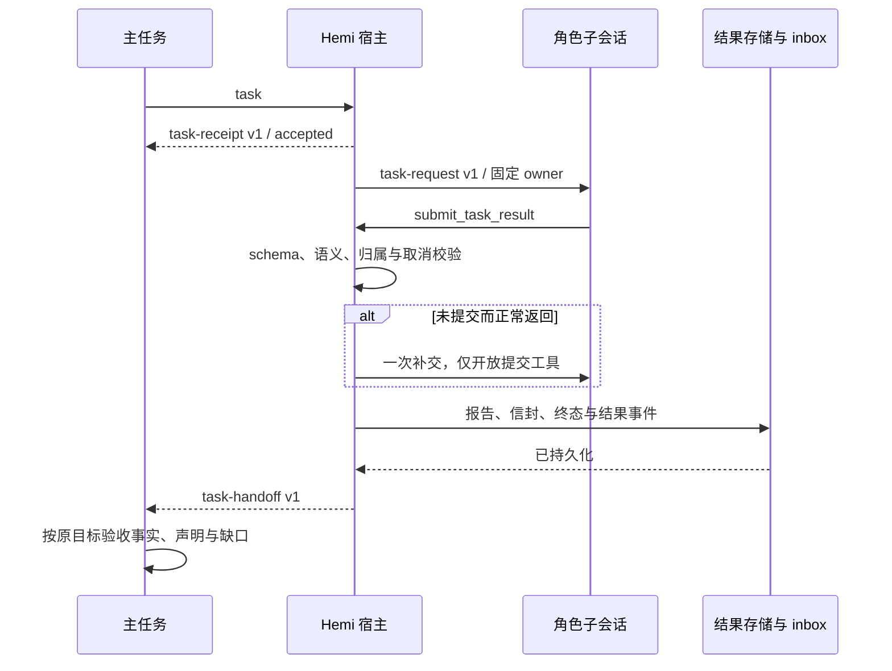

# 子任务返回与后台续跑交接

## 固定交接协议 v1

所有角色与工作流派生子任务共用 `hemi.task-handoff` v1。宿主唯一持有任务身份、根目标、generation、执行终态、后台状态、工具证据、正式成果及报告引用；模型只能调用 `submit_task_result` 提交自己的结论，不能覆盖宿主事实或声明用户授权。工作流节点本身已声明的 `outputSchema` 及其业务输出校验保留；本协议同时约束节点委派给角色的交接。

发往子会话的任务用 `hemi.task-request` v1，固定携带 owner、assignment(objective / description / contextRefs) 与来源；受理回执用 `hemi.task-receipt` v1。补充指令用 `hemi.task-message` v1，携带同一 owner 与 message；排队回执用 `hemi.task-message-receipt` v1，`queued` 不代表已读或已完成。指令不是新增用户授权，归属校验仍由宿主执行。

模型提交必填 `version / summary / completed / remaining / blockers / verification / nextAction`。列表可为空，完成项与未完成项至少一项非空；有缺口、阻塞或验证失败时必须说明下一步。验证项固定为 `check / status(passed|failed|not_run) / evidence`，全部属于模型自述，宿主接收不等于独立验收。拒绝多余字段、空白条目、未知版本、错误枚举与超限数据；总 JSON 不超过 32 KiB。结构化对象完整传输，不从自由文本猜字段，不截断 JSON。

提交工具只对角色子会话开放，提交按任务实例隔离，不从 Pi 历史重建本轮提交。提交后不再接受执行工具；重复相同提交幂等，冲突提交拒绝。整批工具结束后宿主直接收口，不再请求模型多生成一句确认。补交中或已经提交后到达的补充指令明确拒绝，不谎报排队；提交前已入队而尚未消费的补充会令本批提交作废，先消费补充再重新提交，不丢失转向。

未提交而正常停止时，仅补交一次：同一子会话只开放提交工具，以宿主事件要求整理已有结果，禁止重新执行工作。取消、权限拒绝、模型错误、预算收口不触发补交。补交仍缺失时交接标为 missing，保留原文且将任务标为 partial；异常终止标为 interrupted。所属后台命令存在时仍用 handoff，不将其伪装为完成。`execution.pendingBackground` 是子任务收口时的观察，不替代主目标随后读取的进程终态。

宿主生成完整信封 `{protocol,version,owner,execution,submission,evidence}`。`submission.status` 区分 submitted / missing / interrupted / legacy；`submission.data` 仅放校验通过的模型提交。同一信封用于主模型事件、任务查询、工作流报告与持久化档案，旧扁平字段只是兼容展示投影。旧档按 legacy 明示，未知或损坏的新协议拒绝消费，不能静默退化成普通成功报告。报告全文与信封在结果 inbox 受理前落入已有持久化路径，保持根目标归属、generation、取消和幂等边界。

本轮不开放递归派单，不改变目标验收与后台服务等待策略，不把模型自述升级为验证事实。



## 身份与完成语义

后台结果事件在正式 flow 中有独立 `runId`，执行仍属于原目标。`run-preparing` 保存 `rootRunId`，普通运行指向自身，事件运行指向原目标；旧档缺字段时按自身运行处理。子任务投影用该关系匹配委派锚点，并校验 generation，保持同名短调用的跨目标隔离和回卷保护。

子 agent 正常生成结束不证明用户目标完成。新运行有有效提交时使用 `returned`；仍有所属后台命令或未读取命令结果时使用 `handoff`；预算收口或缺少有效提交使用 `partial`，异常中断使用 `unknown`。报告、工具证据、后台结果均继续交给原目标，由主目标按原有流程验收；不追加子任务模型核验，不根据回复中的词语推测完成。

共享 UI 显示“已返回”“已交接”，正常返回不显示完成勾或失败标记。历史 `complete` 继续兼容，不重写既有个人档案。两种新状态也是子任务本轮的终态，启动恢复不会误标中断；会话仍可沿原 sessionRef 续用。工作流将正常返回当作可接收的报告，沿用原有命令收尾及节点验收。

主模型空正文时按后台交接、等待用户、阻塞或预算状态给出宿主说明；已经执行工具的回合不会要求用户重新说一次。正常正文保持原样。

常驻服务、后台进程、前台释放和目标等待继续遵守 [后台命令契约](background-commands.md)，本次不改变服务分类、等待策略、模型选择或递归派单能力。

## 2026-11-01 验证

基线 HEAD `7457783c52932f4a7198380d574d249497867a45` 加本次工作区改动，保留进入本轮前已有的停止／插队修改。macOS arm64，Node 22.22.3；桌面源码 0.2.43，Electron 44.0.0（内置 Node 24.18.1）。

新增的任务投影和返回状态回归在修改前失败，修复后通过。定向回归 121 项通过，覆盖子任务返回、预算收口、历史恢复、会话控制、后台唤醒和真实 Bot SDK／文件工具／重启；只有模型 HTTP 回复受控，执行实现未替换为 mock。

```sh
node --test src/main/agent/subagents.test.mjs src/main/history/task-history.test.mjs src/main/services/task-fact-publisher.test.mjs src/main/services/conversation-controller.test.mjs src/shared/agent-reply.test.mjs src/main/agent-runtime/agent-task-lifecycle.test.mjs src/main/agent-runtime/background-handoff.test.mjs src/main/bot/task-conversation.integration.test.mjs src/main/bot/task-identity.integration.test.mjs
npm run build
npm run typecheck --workspace @hemi/mobile
node scripts/verify-subagent-handoff.mjs
node scripts/verify-subagent-handoff.mjs --dev
git diff --check
```

构建与移动端类型检查通过。桌面开发 renderer 和构建 renderer 各通过 3 组真实链路检查：

- 子任务启动真实受管命令后返回，显示“已交接”，主模型空正文按后台状态回复。
- 命令退出唤醒原目标，事件回合派出第二个任务，委派锚点及任务实体正确绑定；可打开独立过程页，读取实际文件工具结果并显示“已返回”。
- renderer 刷新后，两项任务及原目标关系保留，没有重复用户消息、派单或命令重放。

每次 GUI 验证使用新的临时 `HEMI_USER_DATA_DIR`，仅模型回复合成。证据位于 `.visual/workflow/subagent-handoff/{built,dev}/`，含环境与检查清单、主流和过程页截图；页面错误列表为空。开发 Vite 控制台存在既有 ResizeObserver 通知循环提示。

全量 `npm test`：2290 通过、23 跳过、2 失败，不能称全量通过。失败为命令退出事实保存失败隔离用例，以及 npm 挂起终止用例。独立复验后 npm 用例通过；命令保存失败用例仍失败。在临时 worktree 中还原“HEAD 加本轮之前的 8 个已修改文件”后同样复现 `cleanup-unconfirmed`，属于本次三项修复之前已存在的状态，未混入额外修补。临时 worktree 已清理。日志：

- `/tmp/hemi-session-review-integration.log`
- `/tmp/hemi-session-review-all-tests.log`
- `/tmp/hemi-session-review-failed-recheck.log`
- `/tmp/hemi-session-review-prechange.log`
- `/tmp/hemi-session-review-{build,mobile,built,dev}.log`

未修改个人会话、替换安装版、提交或发布；未验证真实外部模型、生产 Bot、Windows 真机或实体移动设备。已存在历史事件回合缺失的原目标映射不进行个人数据补写。

## 固定协议实施后的验证

仍为 HEAD `7457783c52932f4a7198380d574d249497867a45` 加工作区修改，Node 22.22.3、macOS arm64、Electron 44.0.0，无依赖变更。保留前一轮交接修复与本轮前已有改动。最终定向回归 **233/233 通过**：协议拒绝与幂等、同批提交后禁执行、提交与补充竞态、漏交和取消、真实 Pi SDK、主会话、工作流兼容、角色管理、任务档案／journal 冷恢复、桌面生命周期、Bot 文件工具与重启、委派锚点。

`npm run build`、移动端类型检查和 `git diff --check` 通过。真实开发 renderer 与构建 renderer 各通过 4 组检查，覆盖缺交后的受限补交、真实后台命令、原目标续跑派单、独立过程页、v1 信封持久化与刷新后不重放；截图与报告仍在 `.visual/workflow/subagent-handoff/{built,dev}/`。模型 HTTP 合成，SDK／IPC／存储／文件／命令使用实际实现。

本轮全量 `npm test` 不能称全绿：在外置 APFS 临时目录中为 **2296 通过、23 跳过、4 失败、1 取消**。包括既有 `cleanup-unconfirmed`，后台交接及 Bot 历史的超时、CLI EPIPE，以及 updater 用例对临时目录所在卷的假设。将这 5 个文件放回默认临时目录、低并发独立复验为 **51 通过、1 失败**，仅留下此前已确认在修改前存在的命令保存失败隔离用例。没有为通过测试改动这些无关实现。

最初一轮检查遭遇默认临时目录 ENOSPC 后中止；exFAT 临时目录会生成 AppleDouble 文件并干扰既有历史枚举测试，因此最终使用 `/Volumes/DeveloperCaches-Recovered` 的独立临时目录。本次创建的两个测试临时目录已清理；未改个人应用数据。

主要日志：`/tmp/hemi-fixed-handoff-final-tests.log`、`/tmp/hemi-fixed-handoff-all-tests-apfs.log`、`/tmp/hemi-fixed-handoff-failed-recheck.log`、`/tmp/hemi-fixed-handoff-{build,mobile,built,dev}.log`。仍未提交、安装或发布；真实外部模型对新提交工具的遵循度、生产 Bot、Windows 与实体移动设备未验证。
